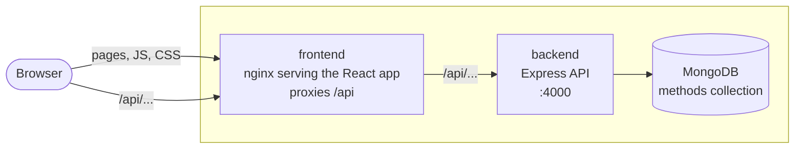
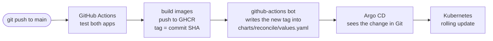
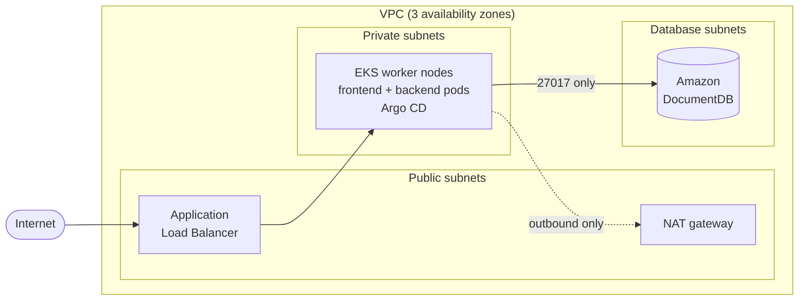

# Reconcile

A small web app that teaches people to solve a Rubik's cube. Pick a method
(Absolute Beginner, CFOP, Roux), paint the colors of your own cube onto a 3D
model, choose a formula, and follow it one turn at a time.

- **Frontend:** React + TypeScript + Vite, three.js for the 3D cube
- **Backend:** Node.js + Express + Mongoose (read-only API for methods and formulas)
- **Database:** MongoDB
- **Delivery:** Docker images on GHCR, a Helm chart, and Argo CD (GitOps)
- **Cloud:** AWS (VPC, EKS, DocumentDB, Application Load Balancer) built with Terraform

> [!TIP]
> New to Kubernetes, Argo CD or AWS networking? Read [docs/](docs/README.md)
> first: it explains every piece of the deployment with stories and diagrams.

---

## Architecture



- The browser only ever talks to the **frontend**. Its nginx serves the built
  React app and forwards anything under `/api` to the **backend**, so there is
  one address and no CORS setup needed.
- The **backend** reads methods, stages and formulas from **MongoDB**. When the
  database is empty it fills it with the starter content in
  [`apps/backend/src/seed/methods.ts`](apps/backend/src/seed/methods.ts).
- The cube logic (moves, notation, orientation) runs entirely in the browser,
  in [`apps/frontend/src/cube/model.ts`](apps/frontend/src/cube/model.ts).

### From a `git push` to the running site



Details: [docs/05-the-pipeline.md](docs/05-the-pipeline.md).

### On AWS



Only the load balancer faces the internet. Worker nodes have no public IPs and
reach out through the NAT gateway. The database subnets have no route to the
internet at all, and DocumentDB accepts connections only from the cluster.
Terraform in [`infra/`](infra/README.md) builds all of this; Argo CD deploys
the app on top. Details: [docs/07-aws.md](docs/07-aws.md).

### Repository layout

```
apps/
  frontend/            React app, its Dockerfile and nginx config template
  backend/             Express API, Mongoose model, seed data, tests, Dockerfile
  docker-compose.yml   Runs mongo + backend + frontend locally
charts/reconcile/      Helm chart (Deployments, Services, MongoDB StatefulSet, ...)
  values-aws.yaml      AWS overrides: DocumentDB + public load balancer
argocd/                Argo CD Applications (minikube and AWS)
infra/                 Terraform for AWS: VPC, EKS, DocumentDB, LB Controller, Argo CD
.github/workflows/
  ci.yml               Test -> build and push images -> bump chart tags
  chart.yml            Lint and validate the Helm chart
  infra.yml            Format and validate the Terraform
docs/                  Beginner-friendly guide to Kubernetes, Helm and Argo CD
```

---

## Running it

You need **Docker**. For development without Docker you also need **Node.js 22**.

### Option 1: Docker Compose (quickest)

```bash
cd apps
docker compose up -d --build
```

Open **http://localhost:8080**. The first start loads the starter methods into
MongoDB automatically.

| Service  | Address                       | Notes |
|----------|-------------------------------|-------|
| frontend | http://localhost:8080         | Change with `FRONTEND_PORT=3000 docker compose up -d` |
| backend  | http://localhost:4000/api     | Bound to localhost only |
| mongo    | mongodb://localhost:27017     | Bound to localhost only, database `reconcile` |

Useful commands:

```bash
docker compose logs -f backend   # one line per API request
docker compose down              # stop (data is kept in the mongo-data volume)
docker compose down -v           # stop and delete the database too
```

> [!CAUTION]
> `docker compose down -v` deletes the `mongo-data` volume, and with it every
> change you made to the data. The starter content is re-seeded on the next start.

### Option 2: Local development (hot reload)

Run MongoDB in Docker and the two apps with Node:

```bash
# Terminal 1: database
cd apps && docker compose up -d mongo

# Terminal 2: API on :4000, restarts on save
cd apps/backend
cp .env.example .env   # optional, defaults work
npm install
npm run dev

# Terminal 3: frontend on :5173, proxies /api to :4000
cd apps/frontend
npm install
npm run dev
```

Open **http://localhost:5173**.

Backend settings (environment variables or `apps/backend/.env`):

| Variable        | Default                                  | Purpose |
|-----------------|------------------------------------------|---------|
| `PORT`          | `4000`                                   | API port |
| `MONGODB_URI`   | `mongodb://localhost:27017/reconcile`    | Database connection |
| `CORS_ORIGIN`   | `http://localhost:5173`                  | Origins allowed to call the API directly |
| `SEED_ON_START` | `false`                                  | Insert starter data when the collection is empty |

Reset the database to the starter content at any time:

```bash
cd apps/backend && npm run seed
```

### Option 3: Kubernetes with minikube and Argo CD

This runs the real deployment setup on your machine: a 3-node cluster, Argo CD
watching this repository, and the images built by CI. If the words in this
section are new, read [docs/02-kubernetes.md](docs/02-kubernetes.md) and
[docs/04-argocd.md](docs/04-argocd.md) first.

**1. Install the tools** (into `~/.local/bin`, no sudo):

```bash
mkdir -p ~/.local/bin
curl -fLo ~/.local/bin/minikube https://storage.googleapis.com/minikube/releases/latest/minikube-linux-amd64
curl -fLo ~/.local/bin/kubectl "https://dl.k8s.io/release/$(curl -fsSL https://dl.k8s.io/release/stable.txt)/bin/linux/amd64/kubectl"
chmod +x ~/.local/bin/minikube ~/.local/bin/kubectl

# Make new terminals find them
echo 'export PATH="$HOME/.local/bin:$PATH"' >> ~/.bashrc && source ~/.bashrc
```

> [!TIP]
> If a new terminal says `kubectl: command not found`, that PATH line is
> missing. See [docs/06-troubleshooting.md](docs/06-troubleshooting.md#kubectl-command-not-found).

Helm is optional for this path (Argo CD renders the chart itself); install it
from https://helm.sh/docs/intro/install/ if you want to run `helm` commands.

**2. Start a cluster:**

```bash
minikube start --nodes 3 --cpus 2 --memory 3g --driver docker
kubectl get nodes
```

**3. Install Argo CD:**

```bash
kubectl create namespace argocd
kubectl apply -n argocd --server-side --force-conflicts \
  -f https://raw.githubusercontent.com/argoproj/argo-cd/v3.6.1/manifests/install.yaml
kubectl -n argocd rollout status deploy/argocd-server
```

**4. Create the MongoDB password** (once per cluster; it never goes into Git):

```bash
kubectl create namespace reconcile
kubectl -n reconcile create secret generic reconcile-mongodb-auth \
  --from-literal=mongodb-root-username=root \
  --from-literal=mongodb-root-password="$(openssl rand -hex 24)"
```

**5. Hand the app to Argo CD:**

```bash
kubectl apply -f argocd/application.yaml
kubectl -n reconcile get pods -o wide -w     # Ctrl+C once everything is Running
```

**6. Open things** (each port-forward keeps running in its own terminal):

```bash
# The app -> http://localhost:8080
kubectl -n reconcile port-forward svc/reconcile-frontend 8080:80

# Argo CD dashboard -> https://localhost:8081 (user: admin)
kubectl -n argocd port-forward svc/argocd-server 8081:443
kubectl -n argocd get secret argocd-initial-admin-secret -o jsonpath='{.data.password}' | base64 -d; echo
```

> [!NOTE]
> The dashboard needs `https://`, and the browser will warn about a self-signed
> certificate (Advanced, then Proceed).

**Pause and resume:**

```bash
minikube stop     # keeps everything
minikube start    # comes back with the same 3 nodes
minikube delete   # wipes the cluster; repeat steps 2-6 afterwards
```

> [!CAUTION]
> `minikube delete` removes Argo CD, the app, the MongoDB data and the password
> Secret. Use `minikube stop` if you want to come back to it.

Something not working? See [docs/06-troubleshooting.md](docs/06-troubleshooting.md).

### Option 4: AWS (EKS + DocumentDB)

The real thing: a VPC with public, private and database subnets across three
availability zones, an EKS cluster, Amazon DocumentDB, and a public load
balancer. Read [docs/07-aws.md](docs/07-aws.md) for the story behind each piece.

> [!WARNING]
> This costs real money, roughly **$300/month (~$10/day)** while it runs,
> even with no visitors. Tear it down when you're done (step 7).

**1. Install the tools** (into `~/.local/bin`, no sudo):

```bash
# AWS CLI v2
curl -fsSLo /tmp/awscliv2.zip https://awscli.amazonaws.com/awscli-exe-linux-x86_64.zip
unzip -q /tmp/awscliv2.zip -d /tmp && /tmp/aws/install --install-dir ~/.local/aws-cli --bin-dir ~/.local/bin

# Terraform
TF_VERSION=1.17.2
curl -fsSLo /tmp/terraform.zip https://releases.hashicorp.com/terraform/${TF_VERSION}/terraform_${TF_VERSION}_linux_amd64.zip
unzip -o -q /tmp/terraform.zip terraform -d ~/.local/bin

aws --version && terraform version
```

You also need `kubectl` (see Option 3, step 1).

**2. Log in to AWS** with a user or SSO role that may create VPC, EKS, IAM,
EC2 and DocumentDB resources:

```bash
aws configure            # or: aws configure sso
aws sts get-caller-identity
```

**3. Ship an up-to-date backend image.** The AWS setup needs the DocumentDB
TLS certificate that's built into recent backend images. Push to `main` and
wait for CI to finish, including the bot's `chore(chart): deploy …` commit.

**4. Build the infrastructure** (~20 minutes):

```bash
cd infra
cp terraform.tfvars.example terraform.tfvars
# edit terraform.tfvars: region, and your IP in cluster_endpoint_public_access_cidrs
#   (find it with: curl -s https://checkip.amazonaws.com)
terraform init
terraform plan        # read what will be created
terraform apply
```

**5. Point kubectl at the new cluster and hand the app to Argo CD:**

```bash
$(terraform output -raw configure_kubectl)
kubectl get nodes                                   # 3 nodes, in private subnets
cd .. && kubectl apply -f argocd/application-aws.yaml
kubectl -n reconcile get pods -w                    # Ctrl+C once all are Running
```

Terraform already created the `reconcile` namespace and the database Secret,
so there's no manual secret step on AWS.

**6. Open the site.** The load balancer takes 2–3 minutes to appear:

```bash
kubectl -n reconcile get ingress reconcile -w
# ADDRESS column: reconcile-...elb.amazonaws.com -> open http://<that address>
```

The Argo CD dashboard works exactly as on minikube (Option 3, step 6).

> [!IMPORTANT]
> kubectl now points at AWS. Switch back with
> `kubectl config use-context minikube`, and check where you are with
> `kubectl config current-context` before deleting anything.

**7. Tear it down:**

```bash
kubectl delete -f argocd/application-aws.yaml
kubectl -n reconcile get ingress     # wait for "No resources found" (the ALB is being deleted)
cd infra && terraform destroy
```

> [!CAUTION]
> Always delete the Application **before** `terraform destroy`. The load
> balancer was created by Kubernetes, not Terraform, so a leftover one blocks
> deleting the VPC and keeps billing. `terraform destroy` also deletes the
> database and its data; no final backup is kept unless you set
> `docdb_skip_final_snapshot = false`.

---

## Tests

```bash
cd apps/backend  && npm test    # API tests against an in-memory MongoDB
cd apps/frontend && npm test    # cube logic and API client
```

Other checks CI runs: `npm run typecheck` (both), `npm run lint` (frontend),
`npm run build` (both), `helm lint` on the chart, and `terraform fmt` and
`terraform validate` on `infra/`.

## API

All responses are JSON. Errors look like `{ "error": "..." }`.

| Endpoint | Returns |
|----------|---------|
| `GET /api/health` | `{ status, db }`, 503 while the database is unreachable |
| `GET /api/methods` | Every method without stages, plus `stageCount` and `formulaCount` |
| `GET /api/methods/:slug` | One method with all stages and formulas |
| `GET /api/methods/:slug/formulas/:id` | One formula, with its stage and method |

## Deployment configuration

The chart's settings live in [`charts/reconcile/values.yaml`](charts/reconcile/values.yaml).
The most common ones:

| Setting | Meaning |
|---------|---------|
| `backend.replicaCount`, `frontend.replicaCount` | How many copies of each run |
| `backend.image.tag`, `frontend.image.tag` | Which build runs. **Set by CI** |
| `mongodb.enabled` | `false` to use an external database via `backend.externalMongodb` |
| `ingress.enabled` | Expose the app on a hostname instead of port-forwarding |

On AWS, [`values-aws.yaml`](charts/reconcile/values-aws.yaml) is layered on
top: DocumentDB instead of in-cluster MongoDB, and an internet-facing ALB.
To serve a domain over HTTPS, set `ingress.hosts` and the commented ACM
certificate annotations there.

Change a value, push to `main`, and Argo CD applies it within a few minutes.

> [!WARNING]
> Don't edit the image tags by hand. The CI bot rewrites them after every
> build; a hand edit is overwritten, or points at an image that doesn't exist.
