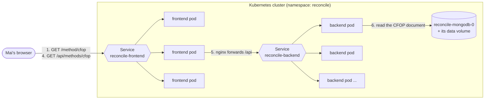
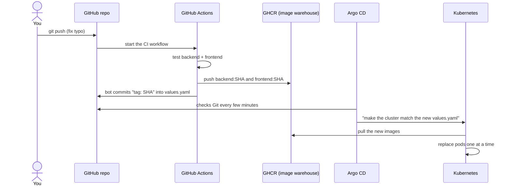
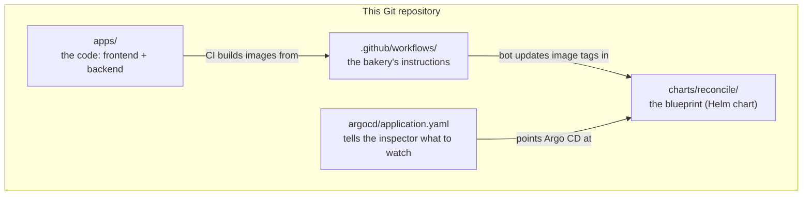

# 1. The big picture

Two short stories cover almost everything. The first follows a **visitor**,
the second follows **a code change**.

---

## Story 1: Mai opens the site

Mai wants to learn CFOP. She opens the site and clicks *CFOP*.

**In the café:** Mai walks in through the front door to the **front counter**
(the frontend). For the menu itself (the page, pictures, layout), the counter
staff hand it over directly. When she asks *"what formulas does CFOP have?"*,
the counter passes the question through a hatch to the **kitchen window**
(the backend Service). Whichever **cook** is free takes it, checks the
**pantry** (MongoDB), and sends the answer back.

What happened, step by step:

1. Mai's browser asks for `/method/cfop`.
2. The **frontend Service** picks one of the 3 frontend pods.
3. That pod's nginx returns the React app (HTML, JavaScript, CSS).
4. The React app, now running in Mai's browser, asks for `/api/methods/cfop`.
5. The frontend's nginx sees `/api` and forwards it to the **backend Service**,
   which picks one of the backend pods.
6. That backend pod reads the CFOP document from MongoDB and returns JSON.
7. React draws the formulas, and the 3D cube starts turning in Mai's browser.

Things to notice:

- Mai never talks to the backend directly. The frontend's nginx forwards
  `/api` for her, so the whole site lives at one address.
- Mai doesn't know or care **which** pod answered. Any copy can serve any
  request. That is what lets us run several copies and lose one without anyone
  noticing.
- The cube animation runs in Mai's browser, not on the server.

> [!TIP]
> **On your laptop:** the "front door" is the
> `kubectl port-forward svc/reconcile-frontend 8080:80` command. It's like a
> private phone line from your house straight to the front counter. In a real
> deployment an **Ingress** (the street entrance) plays that role.

---

## Story 2: You fix a typo and push

You notice a typo in a formula description, fix it, and run `git push`.
You do nothing else, and about five minutes later the live site has the fix.
Here's who did the work.

**In the café:** you send a corrected recipe to the **central bakery**
(GitHub Actions). The bakery taste-tests it (runs the tests), seals new **meal
kits** stamped with a batch number (images tagged with the commit SHA), and
puts them in the **warehouse** (GHCR). A clerk then updates the café's
**official blueprint** (`values.yaml` in Git) to say "use batch 3696f5d".
The **HQ inspector** (Argo CD) notices the blueprint changed and tells the
café manager (Kubernetes). The manager swaps the cooks one at a time to the
new batch, so the café never closes.

The key idea: **you never touch the cluster.** You change Git, and machines
carry the change the rest of the way. That style is called **GitOps**, and
[chapter 4](04-argocd.md) is all about it.

---

## Where each piece lives in the repo

| Folder | Story role | Chapter |
|---|---|---|
| `apps/` | The recipes | Main [README](../README.md) |
| `charts/reconcile/` | The blueprint of the café | [3. Helm](03-helm.md) |
| `argocd/` | The inspector's assignment | [4. Argo CD](04-argocd.md) |
| `.github/workflows/` | The bakery | [5. The pipeline](05-the-pipeline.md) |

Next: [2. Kubernetes →](02-kubernetes.md)
