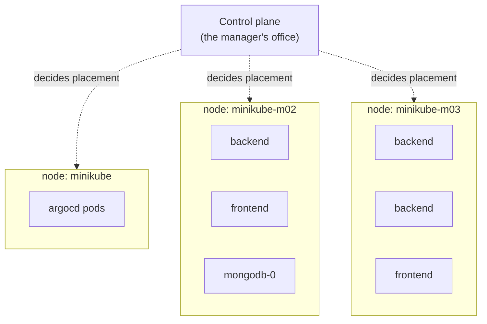
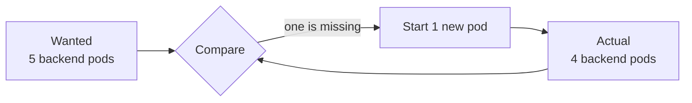
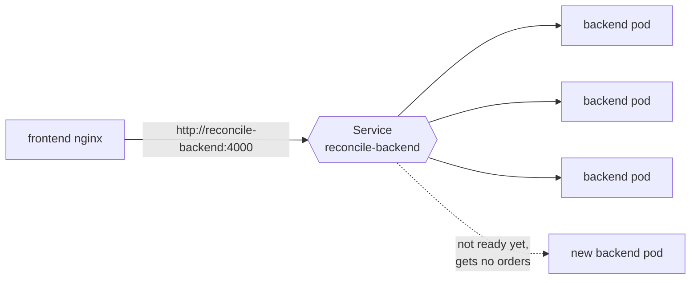
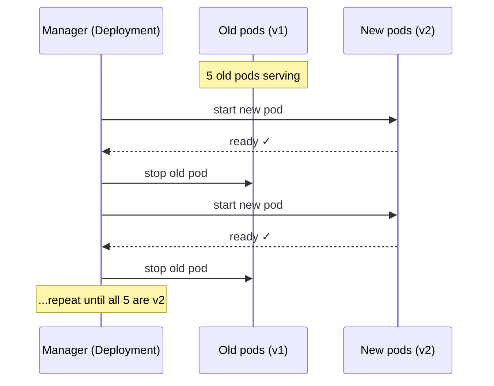
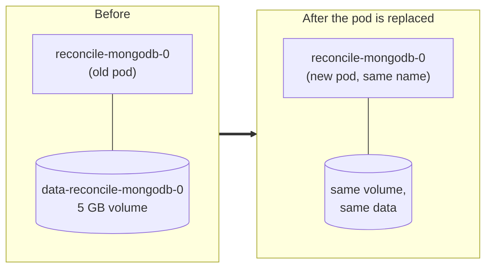
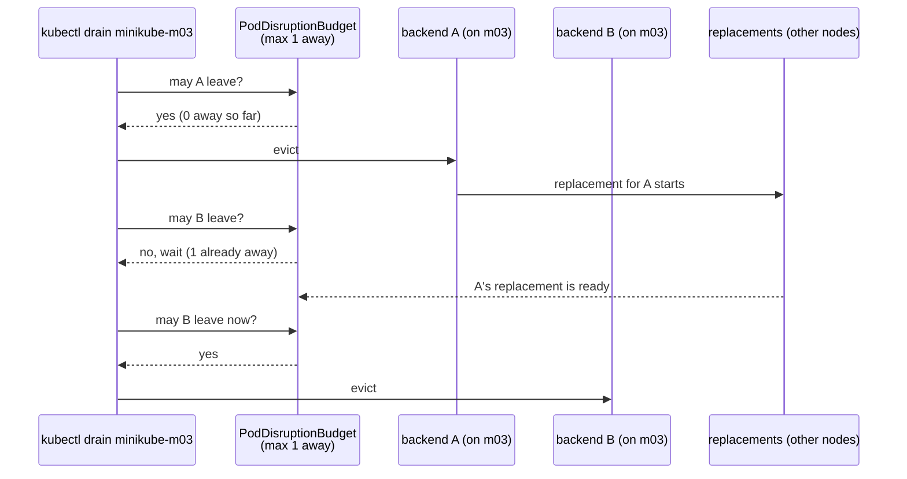
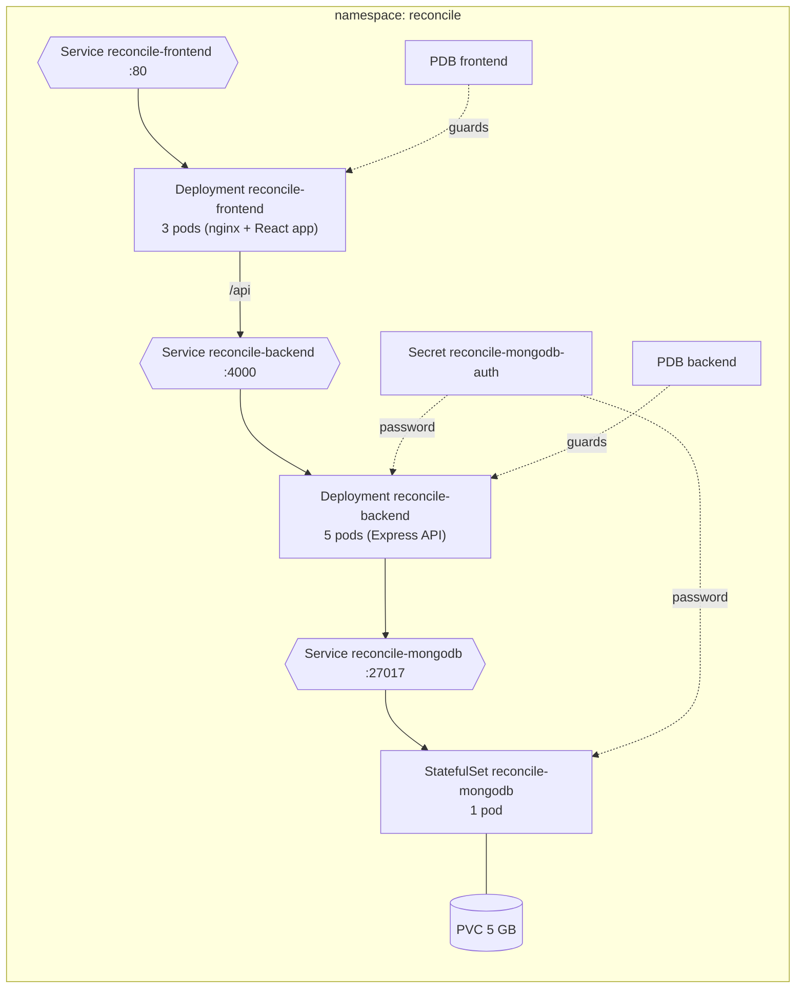

# 2. Kubernetes, one idea at a time

Kubernetes is a **manager for containers**. With Docker Compose *you* start
containers on *one* machine. With Kubernetes you describe what you want, and it
keeps it true across *many* machines, even when things break.

Every section below follows the same pattern: **the story**, **the real
name**, and **where to see it** in this project.

> [!NOTE]
> Commands assume your cluster is running (`minikube start`) and use the
> `reconcile` namespace. Add `-n reconcile` to any `kubectl` command, or set it
> once: `kubectl config set-context --current --namespace=reconcile`.

---

## Cluster and nodes: the café and its kitchens

**Story.** The Reconcile café has three kitchens. A manager's office upstairs
decides which cook works in which kitchen. If one kitchen floods, the manager
moves its cooks to the other two.

**Real names.** Each kitchen is a **node** (one machine, or a virtual machine).
All nodes together form the **cluster**. The manager's office is the
**control plane**: the part of Kubernetes that stores what you asked for and
makes decisions.



**See it:**

```bash
kubectl get nodes
kubectl get pods -o wide      # the NODE column shows which kitchen each cook is in
```

---

## Pods: the cooks

**Story.** A cook is hired, works a shift, and eventually leaves. When a cook
leaves, the manager hires a **new** cook. Same job and same training, but a
different person with a new name badge.

**Real name.** A **pod** is one running copy of your app: a wrapper around one
container (sometimes a few) with its own IP address. Pods are **disposable**.
When one is replaced, the new one gets a new name and a new IP.

```
reconcile-backend-65cfd6fb95-4pkvs
└──── deployment ────┘└ version ┘└ random ┘
```

The middle part changes when you deploy a new version. The last part is
random for each pod.

**See it:**

```bash
kubectl get pods
kubectl logs reconcile-backend-65cfd6fb95-4pkvs      # what this cook has been saying
kubectl describe pod reconcile-backend-65cfd6fb95-4pkvs   # its history: pulled image, started, probes...
```

> [!IMPORTANT]
> Never rely on a pod's name or IP. They change all the time. That's why
> Services exist (two sections below).

---

## Deployments: the staffing rule

**Story.** You don't hire cooks one by one. You give the manager a rule:
*"Always keep **5 backend cooks** on shift, trained on recipe batch
`3696f5d`."* The manager checks the rule constantly. One cook faints? The
manager notices there are only 4 and hires a fifth. You never had to ask.

**Real name.** A **Deployment** stores that rule: which image and how many
copies (**replicas**). Kubernetes keeps comparing *wanted* with *actual* and
fixes the difference. This loop is called **reconciliation**:



This project has two Deployments:

| Deployment | Replicas | Set in |
|---|---|---|
| `reconcile-backend` | 5 | `backend.replicaCount` in `charts/reconcile/values.yaml` |
| `reconcile-frontend` | 3 | `frontend.replicaCount` |

**See it:**

```bash
kubectl get deployments          # READY 5/5 means wanted = actual
kubectl delete pod <any backend pod>
kubectl get pods -w              # watch a replacement appear within seconds
```

---

## Services: the order window

**Story.** Customers don't shout at a specific cook. They hand orders to the
**kitchen window**, which has a fixed sign. Behind the window, orders go to
whichever cook is free and ready. Cooks come and go; the window stays.

**Real name.** A **Service** gives a group of pods one stable name and address,
and spreads requests across them. It finds its pods by **labels** (name tags),
so new pods are picked up automatically.



Our three Services:

| Service | Port | Sends traffic to |
|---|---|---|
| `reconcile-frontend` | 80 | frontend pods (nginx on 8080) |
| `reconcile-backend` | 4000 | backend pods |
| `reconcile-mongodb` | 27017 | the single MongoDB pod |

Inside the cluster, a Service's name works like a web address. That's how the
frontend's nginx finds the backend: `reconcile-backend.reconcile.svc.cluster.local`.

**See it:**

```bash
kubectl get services
kubectl get endpointslices       # which pod IPs are currently behind each window
```

---

## Probes: is this cook ready? still awake?

**Story.** A new cook arrives. Before taking orders they need to set up their
station and check that they can reach the pantry. The manager asks three
questions:

| Question | Probe | Our backend | If the answer is "no" |
|---|---|---|---|
| "Have you finished setting up?" | **startup** | Is port 4000 open? (up to 2 min) | Keep waiting; give up after 2 minutes and restart |
| "Can you take orders right now?" | **readiness** | Does `/api/health` say the database is up? | Take them off the window (no traffic), but don't fire them |
| "Are you still awake?" | **liveness** | Is port 4000 still answering? | Replace the cook |

The difference between readiness and liveness matters. If the **pantry** is
locked (MongoDB down), it isn't the cook's fault. Restarting cooks wouldn't
help, so they just stop taking orders until the pantry opens again. Only a cook
who stops responding entirely gets replaced.

**See it:** `kubectl describe pod <backend pod>` and look at the `Readiness`
and `Liveness` lines and the `Events` at the bottom.

---

## Rolling updates: changing shifts without closing

**Story.** New recipe batch arrives. The manager doesn't send everyone home
and close the café. They bring in **one new cook**, wait until that cook is
ready, send **one old cook** home, and repeat.

**Real name.** A **rolling update**. Our chart sets `maxSurge: 1` (at most one
extra cook during the change) and `maxUnavailable: 0` (never fewer ready cooks
than wanted).



If a new pod never becomes ready (broken release), the rollout **stops there**
and the old pods keep serving. A bad version can't take the site down by
itself.

**See it:** `kubectl rollout status deployment/reconcile-backend`

---

## Namespaces: floors of the building

**Story.** The café shares a building with HQ's inspection office. They're on
different floors, so their staff and signs never get mixed up.

**Real name.** A **namespace** is a folder for Kubernetes objects. We use two:

| Namespace | What lives there |
|---|---|
| `reconcile` | the app: frontend, backend, MongoDB |
| `argocd` | Argo CD itself |

**See it:** `kubectl get pods -n argocd` versus `kubectl get pods -n reconcile`.

---

## StatefulSet and volumes: the pantry keeper

**Story.** Cooks are interchangeable, but the **pantry keeper** isn't. They
have a **personal locker** full of ingredients. If the pantry keeper is
replaced, the new one gets the **same name** and the **same locker**, so
nothing is lost.

**Real names.**
- A **StatefulSet** is like a Deployment for things that hold data. Its pods
  get stable names (`reconcile-mongodb-0`, always `-0`).
- A **PersistentVolumeClaim** (PVC) is the locker: storage that outlives the
  pod. Ours is 5 GB and holds MongoDB's files.



**Why only 1 MongoDB pod?** Several copies of a database must agree on
the data, which needs extra setup (a *replica set*). For learning and local
use one is enough. For production, use a managed database such as MongoDB
Atlas: set `mongodb.enabled: false` in `values.yaml`.

**See it:** `kubectl get statefulset,pvc`

---

## Secrets: the safe

**Story.** The pantry has a combination lock. The combination is kept in a
**safe**. Only the pantry keeper and the cooks are given it, and it is
**never written on the blueprint** that everyone can read.

**Real name.** A **Secret** stores sensitive values. Our MongoDB password is in
`reconcile-mongodb-auth`. You created it by hand (README step 4), so it is
**not in Git**. Both MongoDB and the backend read it from there.

**See it:**

```bash
kubectl get secret reconcile-mongodb-auth                 # exists?
kubectl get secret reconcile-mongodb-auth -o yaml         # values are base64, not encrypted!
```

> [!WARNING]
> Base64 is just encoding, not protection. Anyone who can read Secrets in the
> cluster can read the password, so treat cluster access as sensitive.

---

## Spreading pods across nodes: don't put every cook in one kitchen

**Story.** If all five cooks work in the same kitchen and that kitchen floods,
the café closes. So the manager tries to spread them out.

**Real name.** **Topology spread constraints.** Our chart asks Kubernetes to
spread backend and frontend pods evenly across nodes, **if it can**. On a
tiny cluster it may still double up, which is allowed.

**See it:** the `NODE` column in `kubectl get pods -o wide`.

---

## PodDisruptionBudget: only one cook on break at a time

This one is subtle, so here it is in plain words first.

**Story.** The building owner needs to **renovate kitchen 3**. Before work
starts, everyone in kitchen 3 must move out. The café has a house rule:

> *"During planned work, at most **one** backend cook may be away at a time."*

So the move happens like this:

1. Cook A leaves kitchen 3. A replacement starts in kitchen 1.
2. Cook B also needs to leave. **"Wait,"** says the rule: A's replacement isn't
   ready yet. B stays and keeps cooking.
3. A's replacement is ready. **Now** B may leave, and B's replacement starts.
4. Kitchen 3 is empty, renovation begins, and the café never ran short.

**Real names.** Renovating a kitchen is **draining a node**
(`kubectl drain`), which happens before upgrades or when shrinking a cluster.
The house rule is a **PodDisruptionBudget** with `maxUnavailable: 1`.



> [!IMPORTANT]
> **What it does *not* protect against:** a kitchen that floods without warning
> (a node crash). Nobody asks permission for that. Protection against crashes
> comes from running **several replicas**, not from the PDB.

**See it:**

```bash
kubectl get pdb      # ALLOWED DISRUPTIONS = how many may be away right now
```

---

## Everything in our namespace, on one page



```bash
kubectl get all,pdb,pvc,secret -n reconcile
```

---

## Try it yourself

Small experiments that make the ideas stick. Watch in one terminal with
`kubectl get pods -w`, run the command in another.

| Experiment | Command | What you should see |
|---|---|---|
| A cook disappears | `kubectl delete pod <backend pod>` | A new pod appears within seconds (Deployment) |
| The pantry keeper disappears | `kubectl delete pod reconcile-mongodb-0` | Comes back with the **same name**, data still there |
| Renovate a kitchen | `kubectl drain minikube-m03 --ignore-daemonsets --delete-emptydir-data` | Pods move one at a time (PDB). Then `kubectl uncordon minikube-m03` |
| Change staffing by hand | `kubectl scale deployment reconcile-backend --replicas=2` | Goes to 2, then **back to 5** a moment later. That's Argo CD, see [chapter 4](04-argocd.md) |

> [!TIP]
> Try these on **minikube**, not on the AWS cluster. Draining a node there is
> real maintenance on machines you pay for.

Next: [3. Helm →](03-helm.md)
