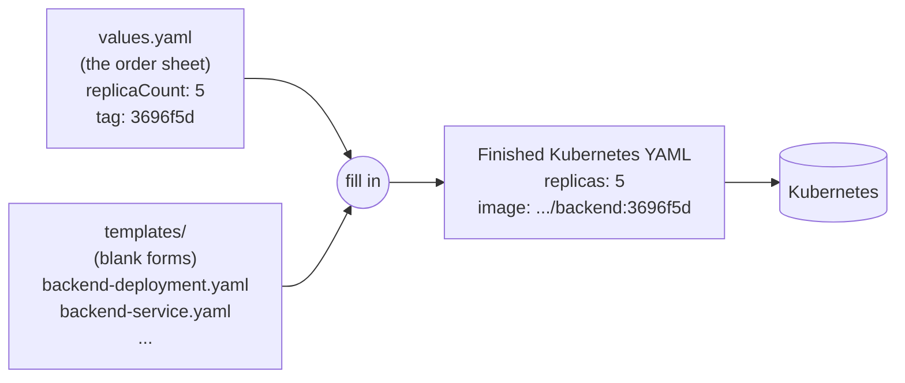

# 3. Helm: blank forms plus one order sheet

## The problem Helm solves

Everything in [chapter 2](02-kubernetes.md) is described to Kubernetes in YAML
files: one for the backend Deployment, one for its Service, one for MongoDB,
and so on. Our app needs about ten of them.

Writing them by hand gets painful fast:

- The name `reconcile-backend` appears in five different files.
- Changing the image tag means finding the right line in the right file.
- A second copy of the app (say, a staging site) means copying every file and
  editing names everywhere.

## The story

**Story.** The café franchise has a **binder of blank forms**: "Staffing
form", "Order window form", "Pantry form". Each form has blanks like
`____ cooks, trained on batch ____`. Next to the binder sits **one order
sheet** with all the answers in one place:

```
backend cooks:  5
backend batch:  3696f5d
frontend cooks: 3
```

A clerk fills every form from the order sheet and hands the finished stack to
the manager. Want 6 cooks? Change **one line** on the order sheet.

**Real names.**

| Story | Helm | In this project |
|---|---|---|
| The binder of blank forms | **templates** | `charts/reconcile/templates/*.yaml` |
| The order sheet | **values** | `charts/reconcile/values.yaml` |
| Binder + order sheet together | a **chart** | `charts/reconcile/` |
| The clerk filling in forms | `helm template` / Argo CD | |
| The finished stack | plain Kubernetes YAML | what actually gets applied |



## What a blank looks like

From `templates/backend-deployment.yaml` (shortened):

```yaml
spec:
  replicas: {{ .Values.backend.replicaCount }}
  ...
      containers:
        - name: backend
          image: ghcr.io/...backend:{{ .Values.backend.image.tag }}
```

From `values.yaml`:

```yaml
backend:
  replicaCount: 5
  image:
    tag: "3696f5d..."
```

The result Kubernetes receives:

```yaml
spec:
  replicas: 5
  ...
      containers:
        - name: backend
          image: ghcr.io/thetangentline/reconcile/backend:3696f5d...
```

`{{ ... }}` marks a blank. `.Values.backend.replicaCount` means "look up
`backend` → `replicaCount` on the order sheet".

## The files in our chart

```
charts/reconcile/
├── Chart.yaml                 name and version of the chart
├── values.yaml                THE order sheet: the only file you normally edit
└── templates/
    ├── _helpers.tpl           shared snippets (names, labels)
    ├── backend-deployment.yaml
    ├── backend-service.yaml
    ├── backend-secret.yaml    only used with an external database
    ├── frontend-deployment.yaml
    ├── frontend-service.yaml
    ├── mongodb-statefulset.yaml
    ├── mongodb-service.yaml
    ├── mongodb-secret.yaml    only when no existing password Secret is given
    ├── pdb.yaml               the "one cook away at a time" rules
    ├── ingress.yaml           off unless ingress.enabled: true
    └── NOTES.txt              message printed after `helm install`
```

## The order sheet, line by line

> [!WARNING]
> Never edit `image.tag` by hand. The CI bot owns those two lines, and a hand
> edit will be overwritten on the next push, or worse, point at an image that
> doesn't exist.

The settings you are most likely to touch in `values.yaml`:

| Setting | What it means | Who changes it |
|---|---|---|
| `backend.replicaCount` | How many backend pods | You |
| `frontend.replicaCount` | How many frontend pods | You |
| `backend.image.tag` | Which backend build runs | **The CI bot. Don't edit by hand** |
| `frontend.image.tag` | Which frontend build runs | **The CI bot** |
| `backend.resources` | CPU/memory each pod asks for and may use | You, rarely |
| `mongodb.enabled` | Run MongoDB in the cluster, or use an external one | You |
| `mongodb.persistence.size` | Size of the database's locker | You, before first install |
| `ingress.enabled` / `ingress.hosts` | Expose the site on a hostname | You, for a real deployment |

### Two values files: the order sheet and the local notes

Argo CD's Application (`argocd/application.yaml`) adds a few answers **on top
of** `values.yaml`, specific to *this* cluster:

```yaml
helm:
  valuesObject:
    mongodb:
      auth:
        existingSecret: reconcile-mongodb-auth
```

Think of it as a sticky note on the order sheet: *"for this café, the pantry
combination is in the safe called `reconcile-mongodb-auth`."* The chart stays
the same for every cluster; the sticky note differs.

## A safety catch: empty image tags

When the chart was first written, the image tags were empty, because no image
had been built yet. Instead of guessing (for example with `latest`), the chart
**refuses to render** and says why:

```
Error: backend.image.tag is empty; it is set by CI after the first image build
```

That's on purpose. A blank should never silently become "whatever is newest".

## Trying Helm yourself (optional)

You don't need Helm for the day-to-day flow; Argo CD fills in the forms for
you. To see what the clerk produces:

```bash
helm template reconcile charts/reconcile -n reconcile \
  --set mongodb.auth.existingSecret=reconcile-mongodb-auth | less

helm lint charts/reconcile          # checks the chart for mistakes
```

Next: [4. Argo CD →](04-argocd.md)
