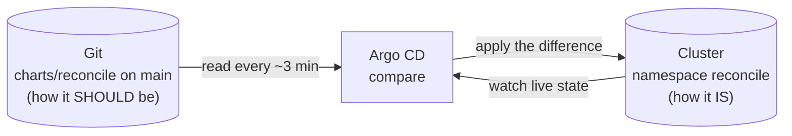
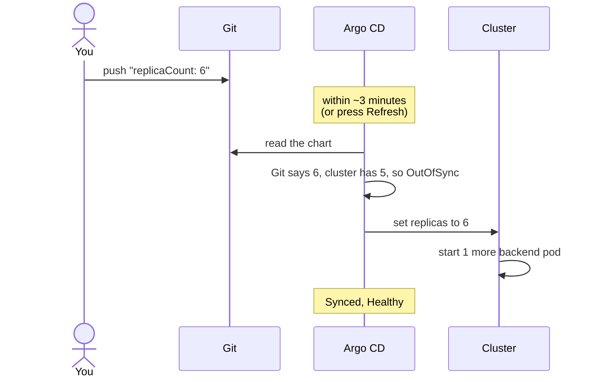

# 4. Argo CD and GitOps

## The idea in one story

**Story.** Head office keeps **one official blueprint** of how the café must
look: how many cooks, which recipe batch, where the pantry is. An **inspector**
from HQ visits every few minutes with that blueprint in hand.

- If the café matches the blueprint, the inspector ticks a box and leaves.
- If the blueprint was **updated** (HQ now wants 6 cooks), the inspector tells
  the manager to change the café to match.
- If someone in the café **changed something on their own** (sent two cooks
  home), the inspector puts it back the way the blueprint says.

Nobody in the café rearranges things directly. **To change the café, you
change the blueprint.**

**Real names.**

| Story | Real name | In this project |
|---|---|---|
| The official blueprint | Your **Git repository** | `charts/reconcile/` on the `main` branch |
| The inspector | **Argo CD** | pods in the `argocd` namespace |
| The inspector's assignment card | an Argo CD **Application** | `argocd/application.yaml` |
| The café | the **cluster** | namespace `reconcile` |
| "Change the blueprint, not the café" | **GitOps** | |



Notice this is the same **reconcile** loop as in [chapter 2](02-kubernetes.md),
one level up:

| Who | Compares | With |
|---|---|---|
| Kubernetes | the Deployment ("5 pods") | the pods actually running |
| Argo CD | Git ("the chart says 5 pods") | the Deployment in the cluster |

## Why bother? Life with and without GitOps

**Without GitOps:** you SSH or `kubectl` into the cluster and change things.
A month later nobody remembers what was changed, by whom, or why. Rebuilding
the cluster means guessing.

**With GitOps:**
- **Every change is a Git commit**, with an author, a date and a message.
- **Undo is `git revert`.**
- **Rebuilding is easy.** Point Argo CD at the repo and it recreates everything.
- **Nobody needs cluster access to deploy.** Pushing to Git is enough.

## The assignment card: `argocd/application.yaml`

In plain words, the file says:

```yaml
source:
  repoURL: https://github.com/TheTangentLine/reconcile.git   # which blueprint
  targetRevision: main                                       # which branch
  path: charts/reconcile                                     # which folder (a Helm chart)
destination:
  namespace: reconcile                                       # which floor of the café
syncPolicy:
  automated:
    prune: true      # remove things that were removed from the blueprint
    selfHeal: true   # undo changes made directly in the cluster
```

You applied this file once with `kubectl apply`. From then on, Argo CD does
the deploying.

## Reading the dashboard

Open it with `kubectl -n argocd port-forward svc/argocd-server 8081:443`, then
**https://localhost:8081** (see the [README](../README.md#option-3-kubernetes-with-minikube-and-argo-cd)).

Each application shows **two** statuses. They answer different questions:

| Sync status: *does the cluster match Git?* | |
|---|---|
| 🟢 **Synced** | Yes, the cluster matches the blueprint |
| 🟡 **OutOfSync** | No, something differs. With auto-sync on, this is usually brief |

| Health status: *is it actually working?* | |
|---|---|
| 💚 **Healthy** | Everything is running and ready |
| 🔵 **Progressing** | Changing: pods starting, rollout in progress |
| ❤️ **Degraded** | Something is failing, e.g. pods crashing or never ready |
| 🟡 **Missing** | Should exist (it's in Git) but doesn't yet |

They're independent. **Synced + Degraded** means "we deployed exactly what Git
says, but what Git says is broken", so the fix goes in Git.

The useful buttons:

| Button | Does |
|---|---|
| **Refresh** | Check Git *now* instead of waiting up to 3 minutes |
| **Sync** | Apply Git to the cluster now (auto-sync already does this) |
| **App Diff** | Show exactly what differs between Git and the cluster |
| Click any box in the tree | See that object's details, events and live YAML; pods also show logs |

## Three stories of Argo CD at work

### Story 1: You change the blueprint

You set `backend.replicaCount: 6` in `values.yaml` and push.



### Story 2: Someone changes the café directly (self-heal)

During testing you run `kubectl scale deployment reconcile-backend --replicas=2`.

1. Kubernetes stops 3 backend pods. The cluster now says **2**.
2. Argo CD notices the cluster no longer matches Git (**5**). Status: OutOfSync.
3. Because `selfHeal: true`, Argo CD sets it back to **5** within seconds.

The same thing happens if you **delete the Deployment**: Argo CD recreates
it. Changes made directly in the cluster don't stick, which is the point.
The only way to change things for good is through Git.

### Story 3: Something is removed from the blueprint (prune)

You had turned on `ingress.enabled: true` and later set it back to `false`.
The Ingress template now produces nothing, but the old Ingress still exists in
the cluster.

Because `prune: true`, Argo CD **deletes** it, since it's no longer in the
blueprint. Without prune it would just be marked as "should be removed" and
left there.

## What happens if I delete...?

| You delete | What happens | Comes back by itself? |
|---|---|---|
| A **pod** | Kubernetes replaces it right away (the Deployment's job) | ✅ Yes, in seconds |
| The **Deployment** or a **Service** | Argo CD sees it's missing and recreates it (self-heal) | ✅ Yes, in seconds |
| The **MongoDB pod** | StatefulSet recreates `reconcile-mongodb-0`; the data volume is reattached | ✅ Yes, data kept |
| The **`reconcile` Application** | Argo CD deletes **everything it deployed**, then the Application itself | ❌ No, see below |

### The one that doesn't come back: deleting the Application

> [!CAUTION]
> Deleting the `reconcile` Application in the dashboard removes the **whole
> app**, not just the Application entry. Only do it on purpose.

Deleting the Application is like **cancelling the inspector's assignment
card**, and the card says *"when cancelled, clear out the café"* (that's the
`resources-finalizer` in the file). So:

1. All Deployments, Services and the StatefulSet in `reconcile` are deleted.
2. The Application disappears from the dashboard.
3. Nothing recreates it, because the Application itself isn't stored in Argo
   CD. **You** created it with `kubectl apply`.

Two things survive:
- The **MongoDB data volume**. Kubernetes keeps StatefulSet volumes on
  purpose, so your data is still there when the app returns.
- The **`reconcile-mongodb-auth` Secret**. You created it by hand, so Argo CD
  never owned it.

To bring everything back:

```bash
kubectl apply -f argocd/application.yaml
```

## Undoing a bad release, the GitOps way

A deploy broke something. Don't fix the cluster by hand: self-heal would undo
your fix. Undo the **Git** change instead:

```bash
git log --oneline              # find the bad commit (or the bot's "deploy" commit)
git revert <commit>            # make a new commit that undoes it
git push
```

Argo CD sees Git moved back and rolls the cluster back to match.

> [!TIP]
> Fixing something live with `kubectl edit` during an emergency is fine, but
> self-heal will undo it within seconds. Make the same change in Git, or
> temporarily turn off auto-sync in the dashboard (*App Details → Disable
> Auto-Sync*) and turn it back on afterwards. The bad
release and its undo both stay in history, so it's clear what happened.

> [!NOTE]
> Argo CD's own *Rollback* button is disabled while auto-sync is on, for the
> same reason: Git is the source of truth, so rollbacks go through Git.

## Why the MongoDB password isn't in the chart

When Argo CD fills in the chart's forms, it **can't see the cluster**: it
works from Git alone. If the chart generated a random password, Argo CD would
generate a **different one every time** it re-read the chart. That's like a
clerk who can't open the safe and writes a new combination on every visit.
MongoDB would still use the first one, and the backend would be locked out.

So for Argo CD we create the password **once, by hand**, in a Secret, and the
Application points the chart at it with `existingSecret: reconcile-mongodb-auth`.
Passwords never go into Git.

Next: [5. The pipeline →](05-the-pipeline.md)
