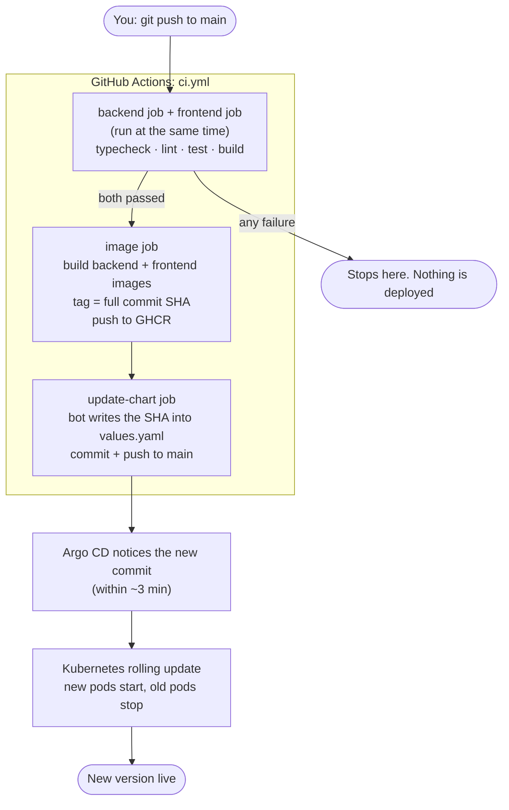

# 5. The pipeline: from `git push` to the live site

## The story

**Story.** A cook at HQ improves a recipe and sends it to the **central
bakery**.

1. The bakery **taste-tests** it. If anything tastes wrong, it goes back
   with a note, and nothing new reaches any café.
2. If it passes, the bakery **seals meal kits** and stamps each one with a
   **batch number** that can never be reused.
3. The kits go to the **warehouse**.
4. A **clerk** updates the official blueprint: *"cafés now use batch
   `3696f5d`."*
5. The **inspector** sees the new blueprint and has the café switch over, one
   cook at a time.

**Real names.**

| Story | Real name | Where |
|---|---|---|
| Central bakery | **GitHub Actions** (CI) | `.github/workflows/ci.yml` |
| Taste-test | **tests, lint, typecheck, build** | jobs `backend` and `frontend` |
| Sealed kit | **Docker image** | job `image` |
| Batch number | **commit SHA** (e.g. `3696f5d…`) | the image tag |
| Warehouse | **GHCR** (GitHub Container Registry) | `ghcr.io/thetangentline/reconcile/...` |
| Clerk | **github-actions[bot]** | job `update-chart` |
| Blueprint | `charts/reconcile/values.yaml` | |
| Inspector | **Argo CD** | [chapter 4](04-argocd.md) |

## The whole flow



You can watch each run in the repo's **Actions** tab on GitHub.

## What the bot's commit looks like

After each successful build you'll see a commit like this on `main`:

```
chore(chart): deploy 3696f5d

Set backend and frontend image tags to 3696f5d...
Built from: check argoCD
```

It changes exactly two lines:

```diff
   image:
     repository: ghcr.io/thetangentline/reconcile/backend
-    tag: "0d1665595896c726151cea94db3357646160d131"
+    tag: "3696f5d..."
```

> [!TIP]
> **Remember to `git pull` before your next change.** The bot added a commit
> to `main` after your push, so your local copy is one commit behind. If you
> forget, `git push` is rejected; `git pull --rebase` fixes it.

## Why the tag is a commit SHA, not `latest`

**Story.** Imagine every kit was stamped "LATEST". A café reports a problem
with its food. Which batch is it? Nobody can say, because "latest" meant
something different last Tuesday.

With commit SHAs:

- **Every image points to exact code.** Tag `3696f5d` is commit `3696f5d`,
  forever.
- **Git always says what's running.** `values.yaml` holds the exact
  tag, so `git log charts/` is your deployment history.
- **Rollback is precise.** Reverting the bot's commit points the cluster back
  at the previous, known image.
- **Argo CD sees a real change.** If the tag were always `latest`, the
  blueprint would never change, so Argo CD would have nothing to deploy.

## Built-in safety rails

| Rail | Protects against |
|---|---|
| Images are built **only if all tests pass** | Shipping code that fails its own tests |
| **Pull requests** build images but don't push or deploy | Unmerged work reaching the cluster |
| The bot edits **only the two tag lines** | Accidentally reformatting `values.yaml` |
| The bot **skips older commits** if a newer one is already deployed | A slow, older run finishing last and rolling the site back |
| The bot's commits **don't trigger CI again** | An endless build → commit → build loop |
| Changes to `charts/`, `argocd/`, `infra/`, `docs/` and `*.md` don't rebuild images | Wasting builds when no app code changed |
| A separate `chart.yml` workflow lints the chart when `charts/` changes | Pushing a broken chart |
| A separate `infra.yml` workflow checks the Terraform when `infra/` changes | Pushing broken infrastructure code |
| Rolling update waits for **readiness** | A broken release replacing working pods (see [chapter 2](02-kubernetes.md#rolling-updates-changing-shifts-without-closing)) |

## Following one change end to end

1. **Push.** `git push`, then open the repo's **Actions** tab.
2. **Tests (about 1–2 min).** The `Backend · test` and `Frontend · test` jobs
   turn green.
3. **Images (about 1–3 min).** `Image · backend` and `Image · frontend`. The
   job summary shows the pushed tag and digest.
4. **Bot commit.** `Update chart image tags`, then `chore(chart): deploy …`
   appears on `main`.
5. **Argo CD (up to 3 min, or press Refresh).** The app goes *OutOfSync* →
   *Progressing* → *Synced, Healthy*.
6. **Pods.** `kubectl -n reconcile get pods -w` shows new pods starting and
   old ones stopping, one at a time.
7. **Check.** `kubectl -n reconcile get deploy reconcile-backend -o jsonpath='{.spec.template.spec.containers[0].image}'`
   prints the new SHA.

## When something goes red

| Red step | Meaning | What to do |
|---|---|---|
| Backend/Frontend test | Your code failed a check | Click the job, read the failing step, fix, push again |
| Image build | Dockerfile or build problem | Same. Try `docker compose build` locally |
| Update chart tags | The bot couldn't push | Usually branch protection on `main`: allow GitHub Actions to push |
| Argo CD *Degraded* | Deployed, but pods are unhealthy | See [Troubleshooting](06-troubleshooting.md) |

Next: [6. Troubleshooting →](06-troubleshooting.md)
