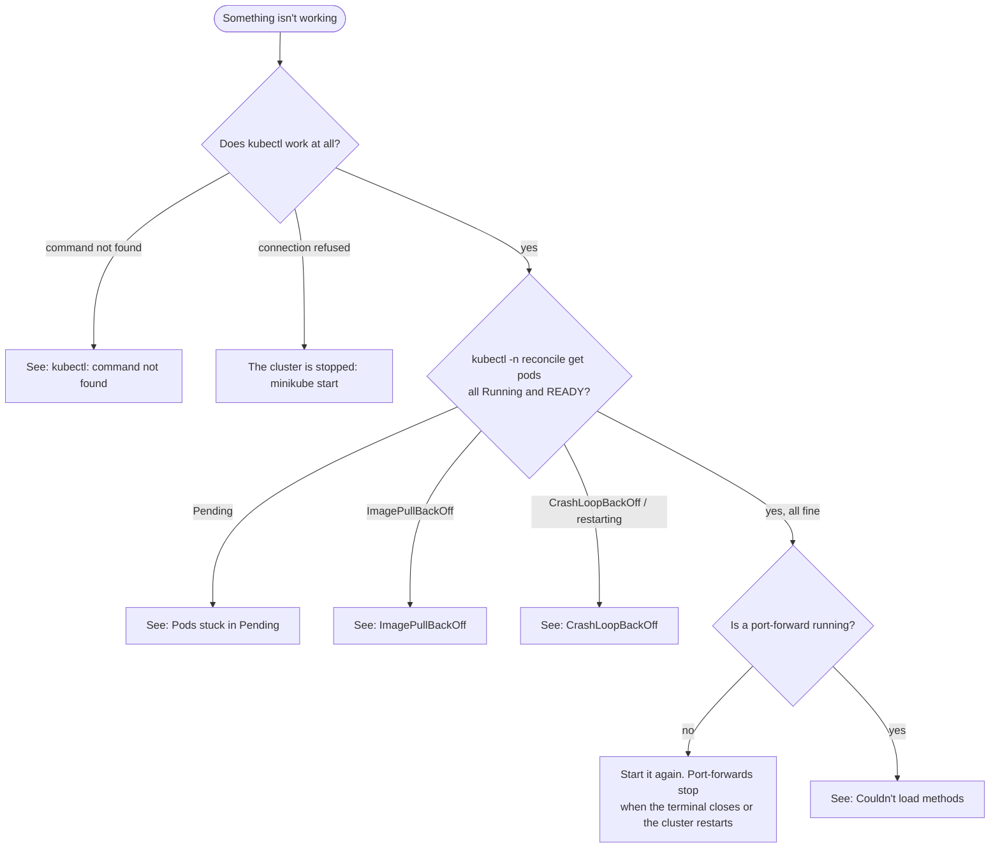

# 6. Troubleshooting and cheat sheet

## Where to start



---

## Problems we've actually hit

### "Couldn't load methods. Can't reach the server."

**What it means.** The page loaded (so the frontend works), but its call to
`/api` failed. The frontend's nginx couldn't get an answer from any backend
pod and returned *502 Bad Gateway*.

**The story behind our first time seeing it.** All 7 pods started at the same
moment, like opening the café with every cook arriving at once while the
pantry keeper was still unlocking the pantry. The backend cooks went to the
pantry, found no one there yet (`getaddrinfo EAI_AGAIN reconcile-mongodb`),
and **walked out**. Kubernetes rehired them, but waits longer after each
walk-out (10s, 20s, 40s...: *CrashLoopBackOff*). So the cooks only came
back about 20 seconds **after** the pantry opened, and Mai's request landed in
that gap.

**The fix (already in the code).** The backend now **waits at the pantry
door** and retries every 2 seconds instead of walking out. Meanwhile it isn't
*ready*, so the order window sends it no orders. You'll see this in its logs:

```
[db] connection attempt 1 failed (...), retrying in 2s
[db] connected to reconcile-mongodb/reconcile
[api] listening on :4000 (production)
```

**If you see the message now:**

```bash
kubectl -n reconcile get pods                     # backends Running and 1/1 READY?
kubectl -n reconcile logs deploy/reconcile-backend --tail=20
kubectl -n reconcile get endpointslices           # any backend IPs listed?
```

Usually it clears up on its own within a minute. Press *Try again*.

### `kubectl: command not found`

**What it means.** kubectl is installed in `~/.local/bin`, but this terminal
doesn't know to look there.

**Why it happened "all of a sudden".** Ubuntu adds `~/.local/bin` to your
PATH from `~/.profile`, which is read **once when you log in**, and only if
the folder already existed then. The folder was created after you logged in.
An older terminal where `source ~/.profile` was run works; a new one doesn't.

**Fix:**

```bash
source ~/.profile                                            # this terminal only
echo 'export PATH="$HOME/.local/bin:$PATH"' >> ~/.bashrc     # every new terminal, permanently
```

### The Argo CD dashboard won't open

Three usual reasons, in order:

1. **No port-forward is running.** Each port-forward must keep running in its
   own terminal:
   ```bash
   kubectl -n argocd port-forward svc/argocd-server 8081:443
   ```
2. **Wrong address.** It must be **https**://localhost:8081, not `http://`.
3. **Certificate warning.** The certificate is self-signed. Click
   *Advanced → Proceed*.

Password for user `admin`:

```bash
kubectl -n argocd get secret argocd-initial-admin-secret -o jsonpath='{.data.password}' | base64 -d; echo
```

---

## Other common situations

### Port 8080 is already in use

Two things want the same port: usually the Docker Compose frontend and the
`kubectl port-forward`. Stop one (`docker compose -f apps/docker-compose.yml down`)
or use another port: `kubectl -n reconcile port-forward svc/reconcile-frontend 8090:80`.

### Pods stuck in `Pending`

The manager can't find a kitchen with enough room (CPU or memory).

```bash
kubectl -n reconcile describe pod <pod>     # look at Events at the bottom: "Insufficient memory"?
kubectl top nodes                           # needs: minikube addons enable metrics-server
```

Fixes: lower `replicaCount` in `values.yaml`, or give minikube more memory
(`minikube delete`, then `minikube start --nodes 3 --memory 4g ...`).

### `ImagePullBackOff` / `ErrImagePull`

The kitchen can't fetch the meal kit from the warehouse.

```bash
kubectl -n reconcile describe pod <pod>     # Events show the exact image and the error
```

- **"not found"**: the tag in `values.yaml` has no image yet. Check that the
  CI run for that commit finished its `Image` jobs.
- **"unauthorized"**: the GHCR package is private. Make it public on GitHub,
  or create a pull secret and set `imagePullSecrets` in `values.yaml`.

### `CrashLoopBackOff`

The container keeps starting and exiting. Kubernetes waits longer between
each retry. Read what it said **before** it died:

```bash
kubectl -n reconcile logs <pod> --previous
```

### Backend logs say `Authentication failed`

The password in `reconcile-mongodb-auth` doesn't match the one MongoDB was
**first started with**. MongoDB only reads the password the very first time it
creates its data. Changing the Secret later doesn't change the database.

- If you changed the Secret: put the old password back.
- If the data doesn't matter (local testing), start the database fresh:

> [!CAUTION]
> This **deletes all data** in the in-cluster MongoDB (minikube). Never run it
> against something you care about.

```bash
kubectl -n reconcile delete statefulset reconcile-mongodb
kubectl -n reconcile delete pvc data-reconcile-mongodb-0
# Argo CD recreates the StatefulSet with an empty volume; the backend re-seeds it
```

### Argo CD says *OutOfSync* and stays that way

```bash
# In the dashboard, App Diff shows exactly what differs.
kubectl -n argocd get application reconcile -o jsonpath='{.status.conditions}'; echo
```

Common causes: a template error in the chart (try `helm lint charts/reconcile`),
or the commit hasn't been pushed. Argo CD reads **GitHub**, not your laptop.

### I pushed, but the site still shows the old version

Go through these in order:
1. Did CI finish, including the bot's `chore(chart): deploy …` commit?
   (GitHub → Actions)
2. Has Argo CD picked it up? It checks every ~3 minutes; press **Refresh**.
3. Are the new pods running? `kubectl -n reconcile get pods`
4. Browser cache: hard-reload with `Ctrl+Shift+R`.

### After `minikube stop` / `start`, nothing opens

Port-forwards don't survive a restart. Start them again. Everything else
(Argo CD, the app, the data) comes back by itself; give it a minute.

---

## Cheat sheet

### Look around

| I want to... | Command |
|---|---|
| See the kitchens (nodes) | `kubectl get nodes` |
| See all app pods and where they run | `kubectl -n reconcile get pods -o wide` |
| Watch pods change live | `kubectl -n reconcile get pods -w` |
| See everything in the app's namespace | `kubectl -n reconcile get all,pdb,pvc,secret` |
| See why a pod is unhappy | `kubectl -n reconcile describe pod <pod>` |
| Read a pod's logs | `kubectl -n reconcile logs <pod>` |
| Read logs from all backend pods | `kubectl -n reconcile logs -l app.kubernetes.io/component=backend --tail=20` |
| Read logs from before the last crash | `kubectl -n reconcile logs <pod> --previous` |
| See recent events (newest last) | `kubectl -n reconcile get events --sort-by=.lastTimestamp` |
| Which image is running? | `kubectl -n reconcile get deploy -o wide` |

### Open things

| I want to... | Command |
|---|---|
| Open the app | `kubectl -n reconcile port-forward svc/reconcile-frontend 8080:80` → http://localhost:8080 |
| Open Argo CD | `kubectl -n argocd port-forward svc/argocd-server 8081:443` → https://localhost:8081 |
| Run a command inside a pod | `kubectl -n reconcile exec -it <pod> -- sh` |
| Open a MongoDB shell | `kubectl -n reconcile exec -it reconcile-mongodb-0 -- mongosh -u root -p` |

### Change things (the GitOps way)

| I want to... | Do this |
|---|---|
| Change replicas, resources, settings | Edit `charts/reconcile/values.yaml`, commit, push |
| Deploy new code | Push to `main`; CI and Argo CD do the rest |
| Undo a release | `git revert <commit>` and push |
| Apply Git now instead of in ~3 min | Argo CD dashboard → **Refresh** |

Changes made with `kubectl edit/scale/delete` on Argo CD-managed objects are
**undone automatically** (self-heal). That's useful for experiments, but not
for permanent changes.

### Cluster on and off

| I want to... | Command |
|---|---|
| Stop the cluster (keeps everything) | `minikube stop` |
| Start it again | `minikube start` |
| Freeze it briefly | `minikube pause` / `minikube unpause` |
| Delete it completely | `minikube delete` (redo README steps 2–6 afterwards) |
| Take a node out for maintenance | `kubectl drain minikube-m03 --ignore-daemonsets --delete-emptydir-data` |
| Put it back | `kubectl uncordon minikube-m03` |

Next: [7. AWS basics →](07-aws-basics.md)
