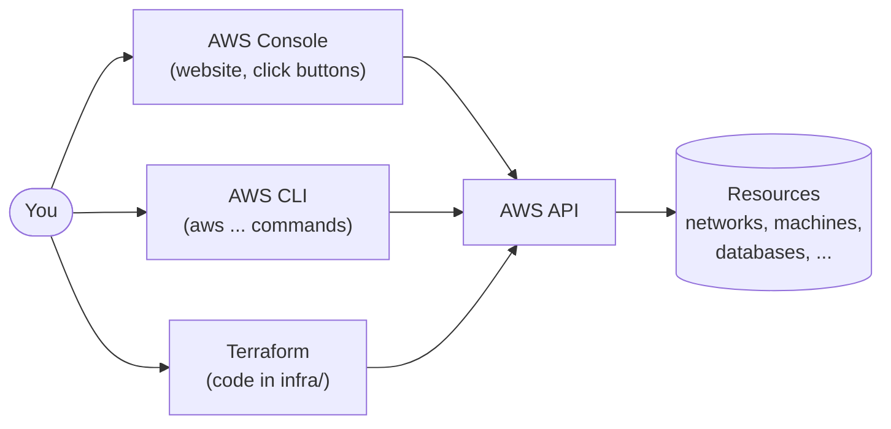
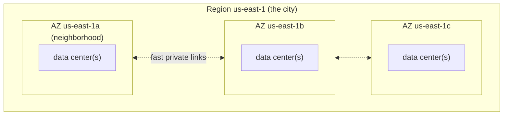
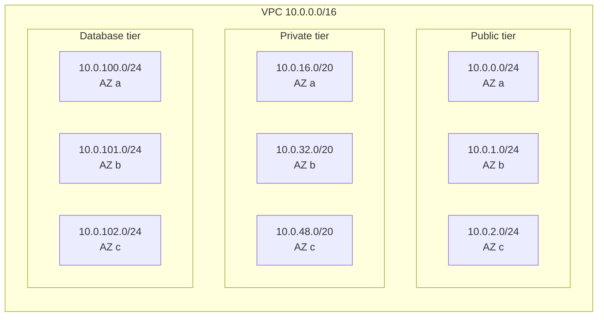
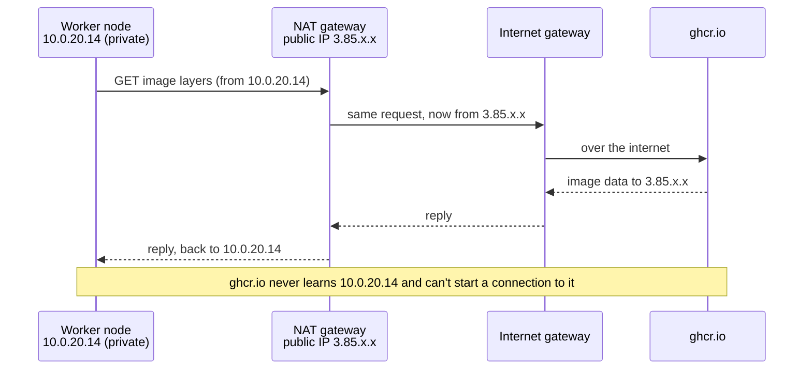
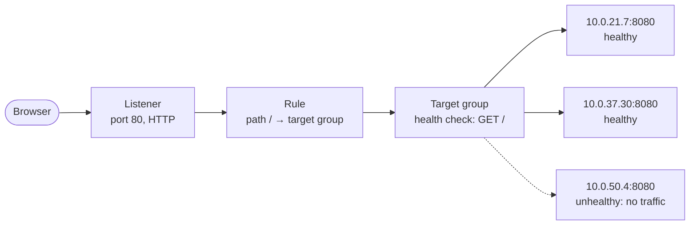
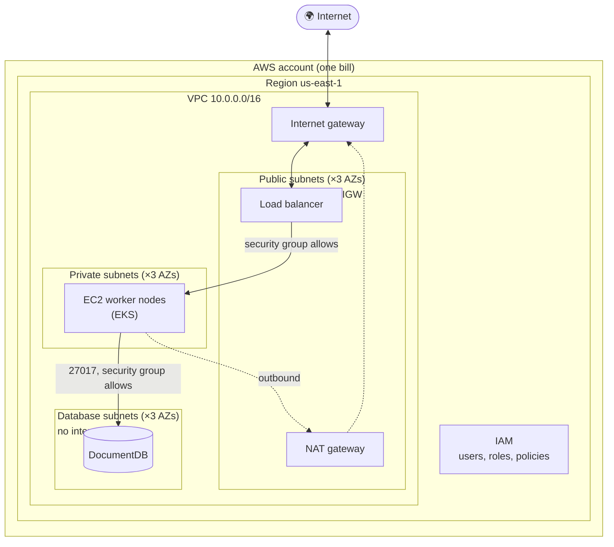

# 7. AWS basics, from zero

Before we put Reconcile on AWS ([chapter 8](08-aws-reconcile.md)), this
chapter explains the AWS ideas that setup is built from. No AWS knowledge is
assumed. Each idea follows the same pattern as before:

- **The story**: the café, now moving from a model village on your desk
  (minikube) into a real city.
- **In plain words**: what the thing actually is.
- **In Reconcile**: where it shows up in this project.
- **See it**: where to find it in the AWS web console, or a command to run.

> [!TIP]
> Don't try to memorize this chapter. Read it once for the shape of things,
> then come back to a section when chapter 8 mentions it. Every heading here
> is linked from chapter 8.

---

## 1. What "the cloud" actually is

**The story.** Instead of building your own café building, you rent space in
a city where the landlord owns all the land, power and roads. You can rent a
kitchen for one afternoon, a storage room for a month, or a front door for a
year. You only pay while you rent.

**In plain words.** AWS (Amazon Web Services) owns huge data centers full of
computers, disks and network equipment. You rent small slices of them **by
the hour (or second)**. Each thing you rent is called a **resource**: a
virtual machine, a disk, a database, a network, a load balancer...

Every resource is created by **calling the AWS API**, a web service that
accepts requests like *"create a network with these addresses"*. There are
three ways to make those calls, and they all end up in the same place:



In this project, **Terraform** makes almost all the calls. You use the
**console** to look around and the **CLI** to log in and run a few commands.

---

## 2. Your account and the bill

**The story.** Your rental agreement with the landlord. Everything you rent
is listed on one monthly bill.

**In plain words.**

- An **AWS account** is a container for everything you create, plus one bill.
  It has a 12-digit ID, like `123456789012`.
- You pay for what runs, **while it runs**: per hour for machines and
  gateways, per GB for storage and data transfer. Stopping using something
  isn't enough; it has to be **deleted** to stop costing money.
- The first login (email + password) is the **root user**. It can do
  anything, including closing the account. Use it only to set things up,
  then work as an IAM user or through SSO (see [IAM](#4-iam-who-is-allowed-to-do-what)).

**In Reconcile.** Terraform puts two **tags** (labels) on everything it
creates: `Project = reconcile` and `ManagedBy = terraform`
(`infra/providers.tf`). Tags let you filter the bill to just this project.

**See it.** Console → **Billing and Cost Management** → **Cost Explorer**,
then *Group by: Tag → Project*.

> [!WARNING]
> Set a budget alert **before** creating anything: Billing → **Budgets** →
> *Create budget* → *Monthly cost budget*, e.g. $50, with an email alert.
> AWS doesn't stop resources when you go over; it only tells you.

---

## 3. Regions and Availability Zones

**The story.** AWS has cafés' worth of land in many **cities** around the
world. Each city is split into **neighborhoods** that have their own power
station, water supply and roads. A flood in one neighborhood doesn't reach
the others, but they're close enough that walking between them is quick.

**In plain words.**

- A **region** is a geographic area, like `us-east-1` (North Virginia) or
  `ap-southeast-1` (Singapore). You pick one, and almost everything you
  create lives there. Pick one close to your users; prices differ a little
  between regions.
- Each region has several **Availability Zones (AZs)**, like `us-east-1a`,
  `us-east-1b`, `us-east-1c`. An AZ is one or more separate data centers with
  independent power and networking, a few kilometers from the others, linked
  by very fast connections.
- Some resources live **in one AZ** (a subnet, a virtual machine, a NAT
  gateway). Others span **the whole region** (a VPC, a load balancer, the
  EKS control plane).



**Why it matters.** Whole AZs do occasionally have problems. If everything
you run sits in one AZ, an outage there takes your app down. Spreading
copies over two or three AZs keeps it up.

**In Reconcile.** We use **3 AZs** (`az_count = 3` in `infra/variables.tf`).
Each layer of the network has one subnet per AZ, and Kubernetes spreads pods
across nodes in different AZs.

| Lives in one AZ | Spans the region |
|---|---|
| Subnets, worker nodes (EC2), NAT gateway, each DocumentDB instance | VPC, load balancer, EKS control plane, DocumentDB storage |

**See it.** The region picker is at the top right of the console. Resources
in another region are invisible until you switch to it.

> [!IMPORTANT]
> "I can't find my cluster!" is almost always the wrong region selected in
> the console. Check the top-right corner first.

---

## 4. IAM: who is allowed to do what

**The story.** The building has **key cards**. Each card says which doors it
opens. Staff get cards for their own areas only; the delivery service gets a
card for the loading dock and nothing else. Cards for machines (the
dishwasher that orders its own detergent) are temporary and renew themselves.

**In plain words.** **IAM** (Identity and Access Management) decides who can
call which AWS API.

| Word | Meaning | Story |
|---|---|---|
| **Identity** | Someone or something making a request | The person or machine holding a card |
| **User** | A person, with a password and/or long-lived access keys | A staff member's personal card |
| **Role** | A set of permissions that someone or something *borrows* for a short time, getting temporary credentials | A visitor card that expires after an hour |
| **Policy** | A JSON document listing allowed (or denied) actions on resources | The list of doors printed on the card |

A policy looks like this:

```json
{
  "Effect": "Allow",
  "Action": ["elasticloadbalancing:CreateLoadBalancer", "elasticloadbalancing:DeleteLoadBalancer"],
  "Resource": "*"
}
```

Everything is **denied by default**; a request succeeds only if some policy
allows it. The habit to aim for is **least privilege**: give each identity
only what it needs.

Services and programs use **roles**, not users. A worker node, or a single
pod, assumes a role and gets temporary credentials that rotate on their own,
so no secret keys are stored anywhere.

**In Reconcile.** These identities exist:

| Identity | Kind | Allowed to | Created by |
|---|---|---|---|
| **You** (running Terraform and kubectl) | user or SSO role | create everything; admin of the cluster | you, in the console |
| EKS cluster role | role | let the EKS control plane manage network interfaces etc. | `infra/eks.tf` (EKS module) |
| Node role | role | let worker nodes join the cluster and pull AWS-managed images | `infra/eks.tf` (EKS module) |
| Load Balancer Controller role | role, used by **one pod** | create and edit load balancers, target groups, security groups | `infra/eks.tf` (Pod Identity module) |

**See it.** Console → **IAM** → **Roles**, search `reconcile`.

> [!CAUTION]
> Never put AWS access keys in code, in Git, or in a chat. If you use access
> keys at all, keep them only in `~/.aws/credentials` (written by
> `aws configure`). Better still, use **IAM Identity Center (SSO)** with
> `aws configure sso`, which gives you short-lived credentials.

---

## 5. IP addresses and CIDR (just enough)

**The story.** Every room in the city has a **street address**. Some
addresses are public, printed on maps. Others are internal ("Room 4, 2nd
floor") and only mean something inside one building.

**In plain words.** Computers find each other by **IP address**, four numbers
from 0 to 255: `10.0.16.25`.

- **Private** addresses are only meaningful inside a network. Three ranges
  are reserved for this: `10.x.x.x`, `172.16–31.x.x` and `192.168.x.x`.
  Thousands of companies use `10.0.0.0` internally; they never clash because
  these addresses are never used on the public internet.
- **Public** addresses are unique worldwide and reachable from the internet.

A **CIDR block** describes a *range* of addresses: `10.0.0.0/16`. The number
after the slash says how many of the leading bits are fixed. Smaller number,
bigger range:

| CIDR | Fixed part | Addresses | Example |
|---|---|---|---|
| `/16` | first 2 numbers | 65,536 | `10.0.0.0/16` = `10.0.0.0` → `10.0.255.255` |
| `/20` | first 2½ numbers | 4,096 | `10.0.16.0/20` = `10.0.16.0` → `10.0.31.255` |
| `/24` | first 3 numbers | 256 | `10.0.1.0/24` = `10.0.1.0` → `10.0.1.255` |
| `/32` | all 4 numbers | 1 | `203.0.113.7/32` = exactly that address |
| `/0` | nothing | all of them | `0.0.0.0/0` = "anywhere" |

AWS keeps **5 addresses** of every subnet for itself (the network address,
the router, DNS, one reserved, and broadcast), so a `/24` gives you 251.

**In Reconcile.** The whole network is `10.0.0.0/16`, split like this
(computed in `infra/network.tf`):

| Range | Size | Used for |
|---|---|---|
| `10.0.0.0/24`, `10.0.1.0/24`, `10.0.2.0/24` | 251 each | public subnets |
| `10.0.16.0/20`, `10.0.32.0/20`, `10.0.48.0/20` | 4,091 each | private subnets (nodes **and pods**) |
| `10.0.100.0/24`, `10.0.101.0/24`, `10.0.102.0/24` | 251 each | database subnets |

The private subnets are much bigger because on EKS **every pod gets its own
address** from the subnet (more in [chapter 8](08-aws-reconcile.md#pods-get-real-vpc-addresses)).

And `cluster_endpoint_public_access_cidrs = ["203.0.113.7/32"]` in
`terraform.tfvars` means "only this one address (yours) may reach the
Kubernetes API".

**See it.** Your own public address: `curl -s https://checkip.amazonaws.com`

---

## 6. VPC: your own private network

**The story.** You buy a plot of land and build a **wall** around it: your
compound. Inside, you decide where the rooms are and which doors exist. By
default the wall has **no gates at all**.

**In plain words.** A **VPC** (Virtual Private Cloud) is an isolated private
network in one region, with an address range you choose (`10.0.0.0/16`).
Resources inside can talk to each other; **nothing can get in or out** until
you add gateways and routes.

Every account also has a **default VPC** in each region, made for quick
experiments. It's very open, so we don't use it; we build our own.

**In Reconcile.** `module "vpc"` in `infra/network.tf`, named `reconcile`.

**See it.** Console → **VPC** → **Your VPCs**. CLI:
`aws ec2 describe-vpcs --filters Name=tag:Project,Values=reconcile`

---

## 7. Subnets: rooms inside the network

**The story.** Inside the wall, you build rooms: a lobby facing the street,
kitchens in the back, a vault in the basement. Each room is in **one
neighborhood** (AZ).

**In plain words.** A **subnet** is a slice of the VPC's address range that
lives in exactly **one AZ**. You put resources into subnets. A subnet isn't
"public" or "private" by any setting; that depends only on its **route
table** (next section).

**In Reconcile.** Nine subnets: three tiers × three AZs.



| Tier | What lives there | Can the internet reach it? | Can it reach the internet? |
|---|---|---|---|
| Public | load balancer, NAT gateway | yes (only things with a public IP) | yes |
| Private | EKS worker nodes and pods | **no** | outbound only, through NAT |
| Database | DocumentDB | **no** | **no** |

**See it.** Console → **VPC** → **Subnets**, filter by the VPC. Names look
like `reconcile-public-us-east-1a`, `reconcile-private-us-east-1a`,
`reconcile-db-us-east-1a`.

---

## 8. Route tables: the signposts

**The story.** In every room there's a **signpost**: "Other rooms in the
compound: this way. Everything else: that way." The lobby's sign points
"everything else" at the street gate. The kitchens' sign points it at the
staff exit. The vault's sign has no "everything else" arrow at all.

**In plain words.** A **route table** is a list of rules: *destination →
where to send it*. Every subnet uses one route table. When a packet leaves a
resource, AWS picks the **most specific** matching rule.

- `local` is always there: traffic to another address in the VPC stays inside.
- `0.0.0.0/0` means "any address not matched by something more specific",
  in practice "the internet".

**In Reconcile.** Three route tables:

| Route table | `10.0.0.0/16` | `0.0.0.0/0` | Result |
|---|---|---|---|
| public | local | **internet gateway** | two-way internet for things with public IPs |
| private | local | **NAT gateway** | outbound-only internet |
| database | local | *(none)* | VPC only, no internet at all |

The database one is set by these lines in `infra/network.tf`:

```hcl
create_database_subnet_route_table     = true   # its own signpost...
create_database_internet_gateway_route = false  # ...with no arrow to the street
create_database_nat_gateway_route      = false  # ...and none to the staff exit
```

**See it.** Console → **VPC** → **Route tables** → pick one → **Routes** tab.

---

## 9. Internet gateway and NAT gateway

### Internet gateway: the street gate

**In plain words.** An **internet gateway** (IGW) connects a VPC to the
internet. Traffic flows both ways, but only for resources that have a
**public IP address**. One per VPC, free.

### NAT gateway: the staff exit (out only)

**The story.** Cooks in the back sometimes need supplies from outside. They
leave through the **staff exit**, and the shop sends the goods back to the
café's return address. But the staff exit has no handle on the outside:
nobody can walk in that way.

**In plain words.** Worker nodes have only private addresses, yet they must
download container images (from GHCR) and call AWS APIs. A **NAT gateway**
(Network Address Translation) sits in a **public** subnet with its own public
IP. Private resources send their outbound traffic to it; it forwards the
traffic under its own address and passes the replies back. A connection can
only be *started from the inside*.



NAT gateways cost money twice: **per hour** (about $0.045 in us-east-1) and
**per GB** they process.

**In Reconcile.** One shared NAT gateway by default
(`single_nat_gateway = true`). The trade-off:

| | One NAT (default) | One per AZ (`single_nat_gateway = false`) |
|---|---|---|
| Cost | ~$35/month | ~$105/month |
| If the NAT's AZ goes down | nodes in all AZs lose outbound internet: no new image pulls, but the running app keeps serving | only that AZ is affected |

**See it.** Console → **VPC** → **NAT gateways** and **Internet gateways**.

---

## 10. Security groups: a guard at every door

**The story.** Every door in the compound has a **guard with a guest list**.
The vault guard's list says: *"Only people wearing a KITCHEN STAFF badge, and
only through this one door."* When someone on the list goes in, they're
always allowed back out.

**In plain words.** A **security group** (SG) is a firewall attached to a
resource's network interface (a machine, a load balancer, a database).

- **Inbound rules** list what may come in: protocol, port, and source. If
  nothing matches, the traffic is dropped.
- **Outbound** is usually "allow everything".
- **Stateful:** if a request was allowed in, its reply is allowed out
  automatically (and the other way round).
- A rule's source can be an IP range (`0.0.0.0/0`) **or another security
  group**: "anything that has security group X attached". That's the badge
  in the story, and it keeps working when machines come and go and their
  IPs change.

**In Reconcile.** The database's security group (`infra/database.tf`) has
exactly two inbound rules:

| Port | From | Meaning |
|---|---|---|
| 27017 (MongoDB) | the EKS **node** security group | worker nodes and their pods |
| 27017 | the EKS **cluster** security group | the cluster's own network interfaces |

Nothing else, from anywhere, can even open a connection to the database.

The load balancer and the nodes get their security groups automatically
(from the EKS module and the Load Balancer Controller); chapter 8 shows them.

> [!NOTE]
> You may also see **Network ACLs** in the console. They're a second,
> subnet-level filter that is *stateless* (replies need their own rule). We
> leave them at the default "allow everything" and do all filtering with
> security groups, which is the common approach.

**See it.** Console → **EC2** → **Security Groups**, search `reconcile`.

---

## 11. EC2: rented computers

**The story.** The kitchens themselves: rooms with stoves and counters that
you rent by the hour.

**In plain words.** An **EC2 instance** is a virtual machine. Things you'll
see:

| Word | Meaning | In Reconcile |
|---|---|---|
| **Instance type** | Its size. `t3.medium` = family **t** (cheap, "burstable"), generation **3**, size **medium**: 2 vCPUs, 4 GiB memory | `node_instance_types = ["t3.medium"]` |
| **Burstable** | `t` types get a baseline of CPU and save up "credits" to go faster in short bursts. Fine for light, spiky loads like ours | |
| **AMI** | The disk image it boots from (operating system and tools) | Amazon Linux 2023, optimized for EKS (`AL2023_x86_64_STANDARD`) |
| **EBS volume** | Its disk: network storage attached to the machine | created per node by EKS |
| **Network interface (ENI)** | A virtual network card with one or more private IPs in a subnet | important for pod addresses (chapter 8) |
| **Auto Scaling group** | Keeps N identical instances running and replaces broken ones | created by the EKS node group |

You don't create the worker machines one by one; the **EKS node group**
asks for them through an Auto Scaling group. If a node dies, a new one
appears in a few minutes. That's the same "keep N running" idea as a
Kubernetes Deployment, one level down.

**See it.** Console → **EC2** → **Instances**: three instances named after
the node group, each with a **Private IPv4** like `10.0.x.x` and **no**
public IPv4.

---

## 12. Load balancers

**The story.** The **host at the front door**. Customers only ever see the
host; the host knows which counters are open and walks each customer to a
free one. If a counter closes, the host stops sending people there.

**In plain words.** A **load balancer** receives traffic on one address and
spreads it over several targets. AWS has two common kinds:

| | Application Load Balancer (ALB) | Network Load Balancer (NLB) |
|---|---|---|
| Understands | HTTP: URLs, hosts, headers, cookies | just TCP/UDP connections |
| Can route by | path (`/api`), hostname | port |
| Typical use | websites and APIs | non-HTTP traffic, extreme throughput |

We use an **ALB**. Its parts:



- A **listener** waits on a port (80 for HTTP, 443 for HTTPS).
- **Rules** decide which **target group** gets a request.
- A **target group** is a list of destinations (IP:port). The ALB
  **health-checks** each one and only sends traffic to healthy ones.
- An ALB must sit in **at least two public subnets** in different AZs. AWS
  runs a piece of it in each.
- It gets a **DNS name** like `k8s-reconcil-...us-east-1.elb.amazonaws.com`.
  Its IP addresses can change, so always use the name.

**In Reconcile.** You never create the ALB yourself. The **AWS Load Balancer
Controller** creates it from the app's Ingress ([chapter 8](08-aws-reconcile.md#4-the-front-door-aws-load-balancer-controller)).

**See it.** Console → **EC2** → **Load Balancers** and **Target Groups**.
The *Targets* tab shows each frontend pod's IP and whether it's healthy.

---

## 13. Managed services: AWS runs the hard part

**The story.** Some jobs are better outsourced: a **management company** runs
the manager's office day and night; a **professional pantry service** keeps
the vault stocked and backed up. You tell them what you want; they do the
work and the night shifts.

**In plain words.** A **managed service** is software AWS operates for you:
installing, patching, backups, replacing failed hardware. You configure it
and pay for it. Two matter here:

| Service | What AWS runs | What's still your job |
|---|---|---|
| **Amazon EKS** | the Kubernetes control plane (API server, etcd, scheduler), highly available across AZs | worker nodes' size and count, Kubernetes version upgrades, everything you deploy |
| **Amazon DocumentDB** | a MongoDB-compatible database: storage replication, backups, failover, patching | instance size and count, who may connect, your data |

This split is AWS's **shared responsibility model**: AWS secures and runs
the underlying platform; you secure what you put on it (who has access,
which ports are open, your passwords).

---

## 14. Terraform in one paragraph

You *could* click all of this together in the console, but you'd never
remember exactly what you clicked, and couldn't rebuild it reliably.
**Terraform** lets you describe the infrastructure in code (`infra/*.tf`),
then makes the AWS API calls to create it. It records what it built in a
**state** file, so next time it can show you exactly what will change before
changing it. [Chapter 8, section 7](08-aws-reconcile.md#7-terraform-properly-explained)
goes through it properly.

---

## Chapter 7 on one page



If you can explain each box and arrow in this picture, you're ready for
[chapter 8](08-aws-reconcile.md), which builds exactly this for Reconcile.

Next: [8. Reconcile on AWS →](08-aws-reconcile.md)
