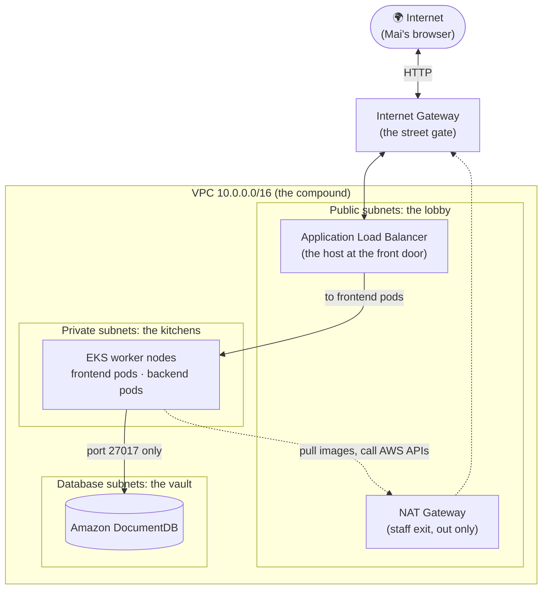
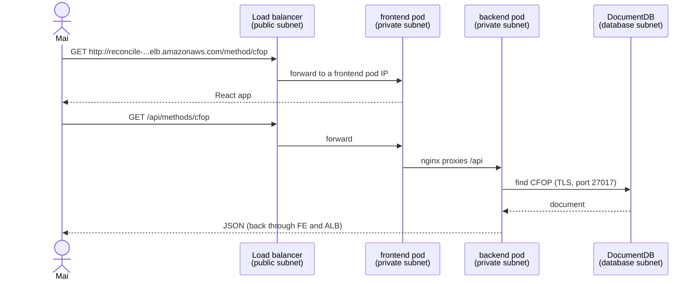
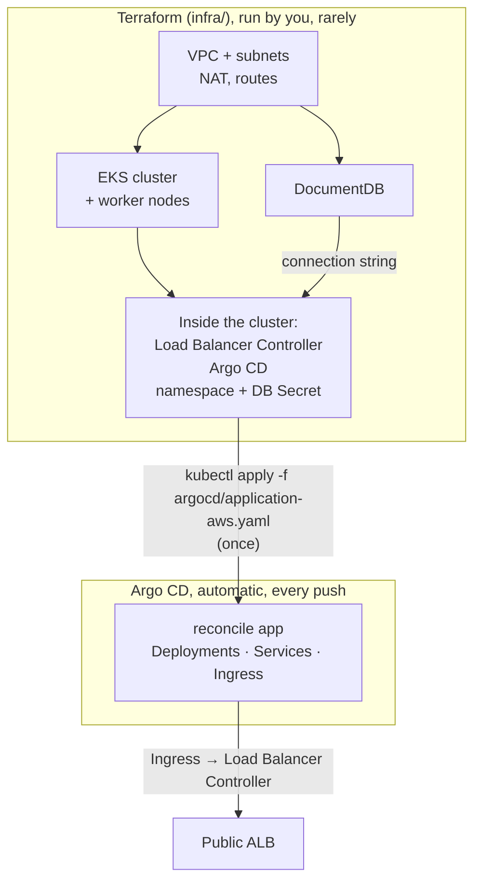

# 7. AWS: the café opens in a real city

Until now the café ran in a **model village on your desk** (minikube). This
chapter moves it into a **real city**: Amazon Web Services. Real streets, real
customers, real rent.

> [!WARNING]
> Unlike minikube, AWS charges by the hour, whether anyone visits or not.
> Read [What it costs](#what-it-costs) before running `terraform apply`, and
> [tear it down](#closing-the-café-teardown) when you're done experimenting.

---

## The story: building the café's property

**Story.** You buy a plot of land in the city and build a walled
**compound** on it. Inside the wall there are three areas, from front to back:

1. **The lobby** faces the street. It has the **front door** with a host who
   greets customers and walks each one to a free counter. Next to it is a
   **staff exit**: staff can go *out* through it to fetch supplies, but it
   doesn't open from outside.
2. **The kitchens** are behind the lobby. They have **no street door at
   all**. Customers only reach them through the host. Cooks go out for
   supplies through the staff exit.
3. **The vault** is in the basement and holds the pantry. It has **no route
   outside whatsoever**. A guard at its door lets in **only kitchen staff**.

To survive a power cut in one part of town, the café builds a copy of all
three areas in **three different neighborhoods** of the city.

**Real names.**

| Story | AWS name | In this project |
|---|---|---|
| The city | **Region** | `us-east-1` (set in `terraform.tfvars`) |
| A neighborhood with its own power and water | **Availability Zone** (AZ) | 3 of them, e.g. `us-east-1a/b/c` |
| The walled compound | **VPC** (Virtual Private Cloud) | `10.0.0.0/16` |
| The street gate in the wall | **Internet Gateway** | created by the VPC module |
| The lobby | **public subnets** | `10.0.0.0/24`, `10.0.1.0/24`, `10.0.2.0/24` |
| The host at the front door | **Application Load Balancer** (ALB) | created from the Ingress |
| The staff exit (out only) | **NAT Gateway** | one, shared |
| The kitchens | **private subnets** | `10.0.16.0/20`, `10.0.32.0/20`, `10.0.48.0/20` |
| The vault | **database subnets** | `10.0.100.0/24`, `10.0.101.0/24`, `10.0.102.0/24` |
| Signposts in each area ("the exit is that way") | **route tables** | one per tier |
| Guards with a guest list at each door | **security groups** | e.g. "DocumentDB: port 27017 from EKS nodes only" |



What each area can do:

| From ↓ / To → | Internet | Lobby (public) | Kitchens (private) | Vault (database) |
|---|---|---|---|---|
| **Internet** | | ✅ load balancer only, port 80 | ❌ | ❌ |
| **Lobby** | ✅ | | ✅ ALB → frontend pods | ❌ |
| **Kitchens** | ✅ outbound, through NAT | ✅ | | ✅ port 27017 only |
| **Vault** | ❌ no route at all | ❌ | ✅ replies only | |

> [!NOTE]
> "Public" and "private" are just about **routes**. A public subnet has a
> signpost to the internet gateway; a private subnet's signpost points at the
> NAT (out only); the database subnets have no signpost out at all. That's
> why nothing in the vault can be reached from, or reach, the internet.

### Why three neighborhoods?

An Availability Zone is a separate data center with its own power and
network. Each tier has one subnet **per AZ**, and Kubernetes spreads pods
across nodes in different AZs (the *topology spread* from
[chapter 2](02-kubernetes.md#spreading-pods-across-nodes-dont-put-every-cook-in-one-kitchen)).
If one AZ goes dark, the café keeps serving from the other two.

> [!TIP]
> To save money there's **one** shared NAT gateway by default. If its AZ goes
> down, the kitchens lose their staff exit (no new image pulls), but the café
> keeps serving. For production, set `single_nat_gateway = false` to get one
> per AZ.

---

## Who runs what in the compound

**Story.** You don't want to manage the manager. So you hire a
**management company** (Amazon EKS) to run the manager's office: it's
always staffed, upgraded and backed up. You only **rent the kitchens** (EC2
worker nodes), and the company replaces a kitchen if it breaks.

For the pantry, you hire a **professional pantry service** (Amazon
DocumentDB). They run the vault, take a backup every night, and keep
everything locked (encrypted).

One more character: the **liaison to city hall**. Whenever you put up a sign
inside the café saying *"the front door is here"* (an **Ingress** object), the
liaison calls the city and has a real entrance built (an **Application Load
Balancer**). That's the **AWS Load Balancer Controller**. To make those calls
it carries a **staff badge** that city hall recognizes (**EKS Pod
Identity**, which gives it IAM permissions).

| Story | AWS name | Created by |
|---|---|---|
| Management company running the manager's office | **Amazon EKS** control plane | Terraform (`infra/eks.tf`) |
| Rented kitchens | **EKS managed node group** (3 × `t3.medium`, up to 4) | Terraform |
| Professional pantry service | **Amazon DocumentDB** (MongoDB-compatible) | Terraform (`infra/database.tf`) |
| Liaison to city hall | **AWS Load Balancer Controller** | Terraform (Helm release) |
| The liaison's staff badge | **EKS Pod Identity** + IAM role | Terraform |
| The HQ inspector | **Argo CD** | Terraform (Helm release) |
| The café itself: cooks, windows, front-door sign | the **app** (Deployments, Services, Ingress) | **Argo CD**, from Git |

### Mai's visit, on AWS



The only difference from minikube: the **front door** is a real load
balancer instead of `kubectl port-forward`, and the **pantry** is DocumentDB
instead of the `reconcile-mongodb-0` pod.

---

## Two kinds of blueprint: Terraform and Argo CD

**Story.** There are now two sets of plans:

- The **architect's plans** describe the **building**: the wall, the
  lobby, the kitchens, the vault, which doors exist. Changing them means
  construction work. That's **Terraform**, in `infra/`.
- The **café blueprint** describes **what happens inside**: how many cooks,
  which recipe batch. That changes every day. That's the **Helm chart +
  Argo CD**, in `charts/` and `argocd/`.

The architect also keeps a **ledger** of everything that has been built, so
the next time the plans change, they know what to add, change or knock down.
That ledger is the **Terraform state**.



| | Terraform | Argo CD |
|---|---|---|
| Manages | AWS resources: network, cluster, database | Kubernetes objects of the app |
| Lives in | `infra/` | `charts/reconcile/` + `argocd/` |
| Runs when | You run `terraform apply` | Automatically, after every push |
| Changes | Rarely (weeks or months) | Often (every deploy) |
| Remembers what it built in | `terraform.tfstate` | the cluster itself |

> [!CAUTION]
> `terraform.tfstate` contains the **database password** in plain text and
> is the only record of what was built. Never commit it (it's in
> `infra/.gitignore`). For anything long-lived, move it to an encrypted S3
> bucket: see `infra/backend.tf`.

### How the backend finds the pantry

Terraform creates the database **and** a Kubernetes Secret,
`reconcile-backend-db`, holding the full connection string. The chart's
`values-aws.yaml` tells the backend to read it:

```yaml
mongodb:
  enabled: false                # no in-cluster MongoDB on AWS
backend:
  externalMongodb:
    existingSecret: reconcile-backend-db
```

The connection uses TLS. DocumentDB's certificates are signed by Amazon's own
authority, which isn't trusted by default, so the backend image includes
Amazon's CA bundle at `/app/certs/rds-global-bundle.pem`.

---

## Opening the café: step by step

The commands are in the [main README](../README.md#option-4-aws-eks--documentdb).
Here's what each step does, in story terms:

| Step | Command | What happens in the story |
|---|---|---|
| 1 | `terraform apply` | The architect builds the compound, hires the management company, rents 3 kitchens, opens the vault, and hires the liaison and the inspector. **~20 minutes.** |
| 2 | `aws eks update-kubeconfig ...` | You get a key to the manager's office (kubectl now talks to EKS) |
| 3 | `kubectl apply -f argocd/application-aws.yaml` | You hand the inspector the blueprint |
| 4 | *(automatic)* | The inspector staffs the café; the liaison has the front door built. **~3 minutes.** |
| 5 | `kubectl -n reconcile get ingress` | You read the front door's street address and open it in a browser |

> [!IMPORTANT]
> The backend needs an image that includes the DocumentDB certificate. Push
> your latest code to `main` and let CI finish (including the bot's
> `chore(chart): deploy …` commit) **before** step 3.

## What it costs

Rough on-demand prices in `us-east-1`. Check the
[AWS Pricing Calculator](https://calculator.aws/) for your region.

| Piece | Approx. per month |
|---|---|
| EKS control plane | ~$73 |
| 3 × `t3.medium` worker nodes | ~$91 |
| DocumentDB `db.t3.medium` (1 instance) + storage | ~$60 |
| NAT gateway (+ data) | ~$35 |
| Application Load Balancer | ~$20 |
| Public IPv4 addresses, disks, logs | ~$20 |
| **Total** | **~$300 / month ≈ $10 / day** |

> [!TIP]
> Learning? Run it for an afternoon, then tear it down. Recreating it is one
> `terraform apply`, and the app returns by itself through Argo CD.

## Closing the café: teardown

**Story.** Before demolishing the building, ask the liaison to **remove the
front door** they had the city build. The architect didn't build it, so it
isn't in their ledger. If it's still standing, the city refuses to demolish
the compound around it.

```bash
# 1. Remove the app first, so the Load Balancer Controller deletes the ALB
kubectl delete -f argocd/application-aws.yaml
kubectl -n reconcile get ingress        # wait until "No resources found"

# 2. Then demolish everything Terraform built
cd infra && terraform destroy
```

> [!CAUTION]
> Skipping step 1 leaves the load balancer behind. `terraform destroy` then
> fails or hangs on the VPC (the ALB is still using its subnets), and the
> forgotten ALB keeps costing money. If that happens, delete the
> `k8s-reconcil-...` load balancer in the EC2 console and run
> `terraform destroy` again.

> [!WARNING]
> `terraform destroy` deletes the DocumentDB database **and its data**. By
> default no final backup is kept (`docdb_skip_final_snapshot = true`). Set
> it to `false` first if the data matters.

## Switching between minikube and AWS

kubectl can know about several clusters. Each is a **context**:

```bash
kubectl config get-contexts             # * marks the current one
kubectl config use-context minikube     # back to the model village
kubectl config use-context arn:aws:eks:us-east-1:...:cluster/reconcile   # the real city
```

> [!IMPORTANT]
> Always check which cluster you're pointing at before running `delete`,
> `drain` or `scale`. `kubectl config current-context` tells you.

← Back to the [docs index](README.md)
