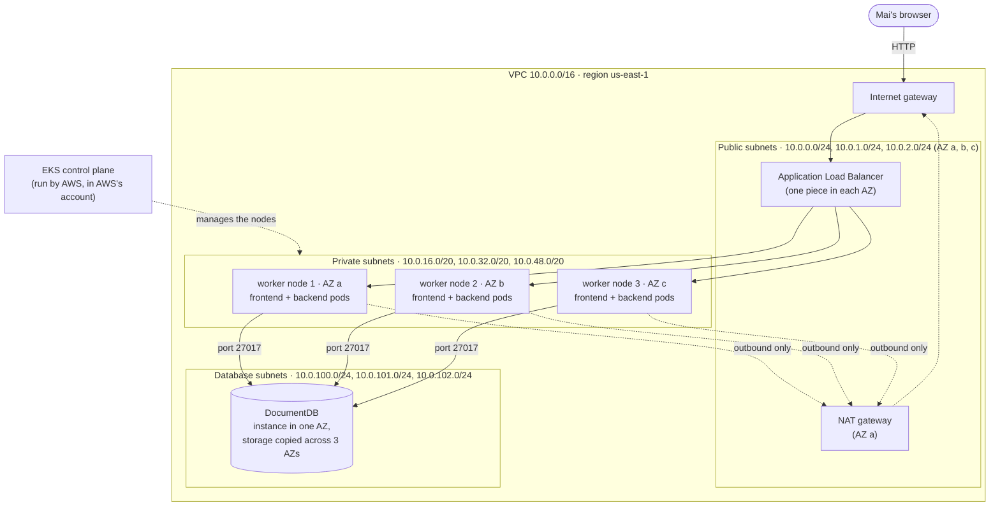
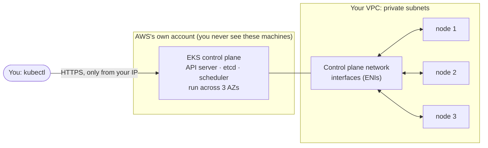
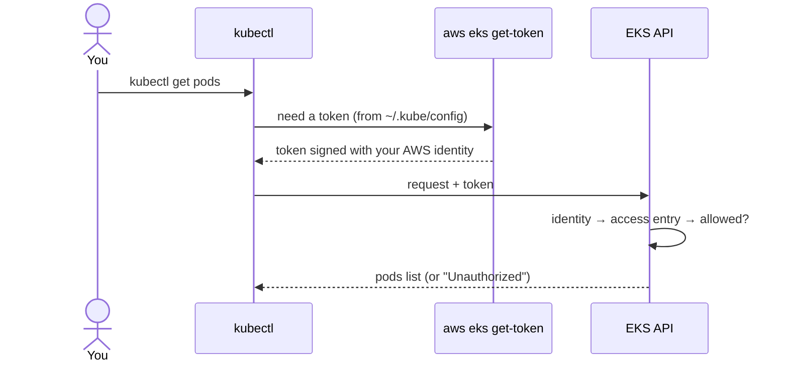
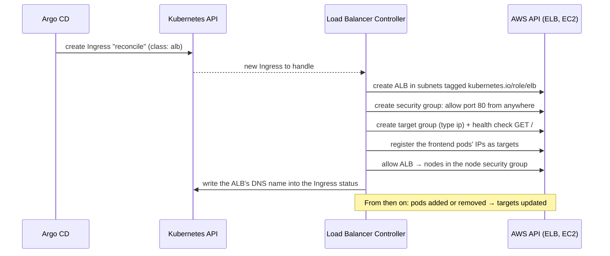
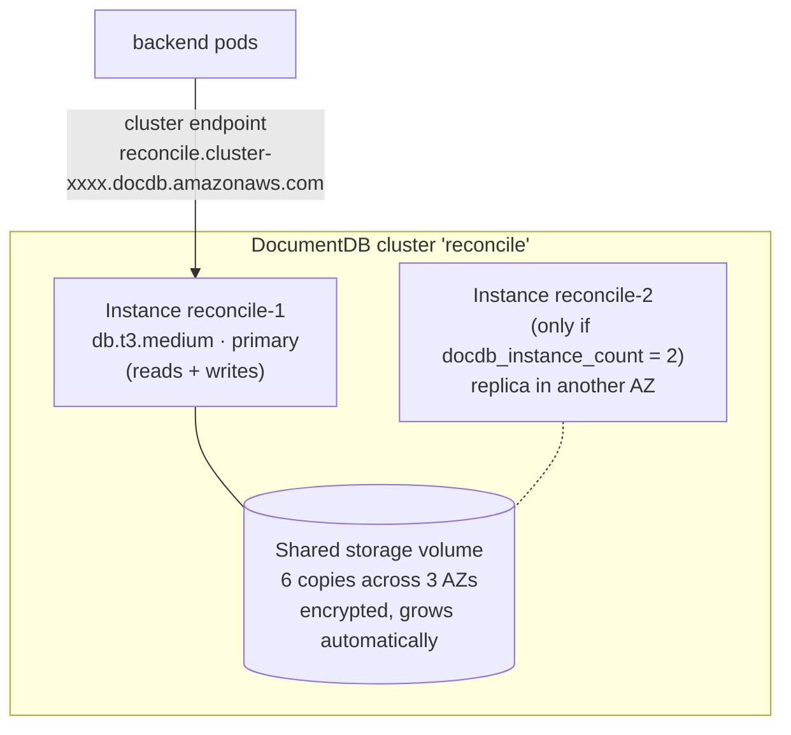
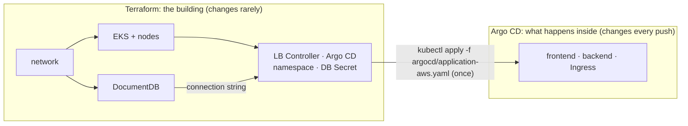
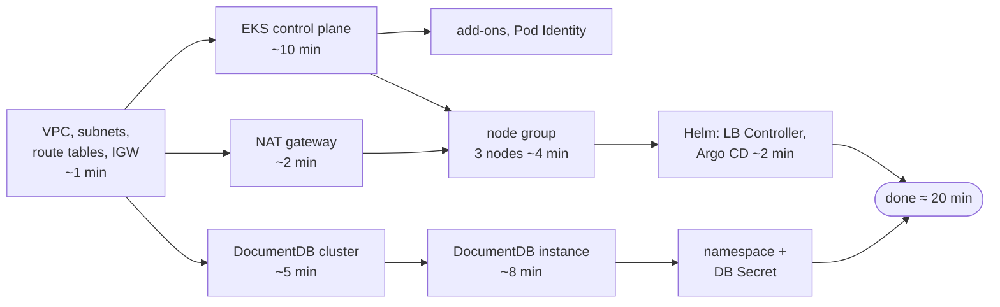
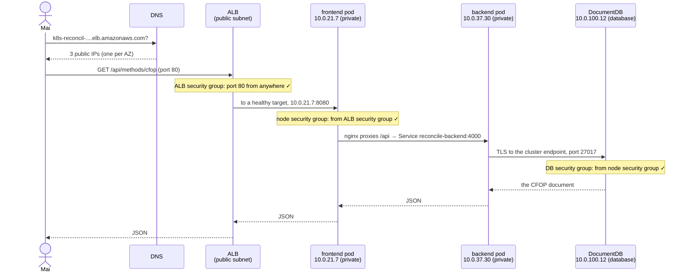
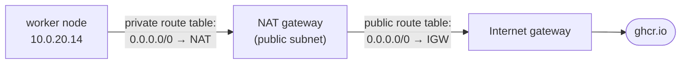

# 8. Reconcile on AWS, step by step

[Chapter 7](07-aws-basics.md) explained the AWS building blocks. This chapter
shows how `infra/` puts them together for Reconcile: what each piece does,
which file creates it, how a request travels through it, what it costs, and
what to do when something goes wrong.

The café story continues: the café has moved into a **walled compound** in a
real city, with a **lobby** facing the street (public subnets), **kitchens**
behind it with no street door (private subnets), and a **vault** in the
basement (database subnets).

---

## 1. The whole picture



| Piece | What it does | Created by | Section |
|---|---|---|---|
| VPC, 9 subnets, route tables, internet gateway, NAT | the network | `infra/network.tf` | [2](#2-the-network) |
| EKS cluster and 3 worker nodes | runs Kubernetes | `infra/eks.tf` | [3](#3-eks-kubernetes-run-by-aws) |
| AWS Load Balancer Controller + its IAM role | turns the Ingress into a load balancer | `infra/eks.tf`, `infra/kubernetes.tf` | [4](#4-the-front-door-aws-load-balancer-controller) |
| Application Load Balancer | the public front door | the Load Balancer Controller (not Terraform!) | [4](#4-the-front-door-aws-load-balancer-controller) |
| DocumentDB | the database | `infra/database.tf` | [5](#5-the-pantry-amazon-documentdb) |
| Argo CD, `reconcile` namespace, DB Secret | inside the cluster | `infra/kubernetes.tf` | [6](#6-what-terraform-installs-inside-the-cluster) |
| The app (frontend, backend, Ingress) | Reconcile itself | **Argo CD**, from Git | [6](#6-what-terraform-installs-inside-the-cluster) |

---

## 2. The network

*File: `infra/network.tf`. Background: [VPC](07-aws-basics.md#6-vpc-your-own-private-network),
[subnets](07-aws-basics.md#7-subnets-rooms-inside-the-network),
[route tables](07-aws-basics.md#8-route-tables-the-signposts),
[NAT](07-aws-basics.md#9-internet-gateway-and-nat-gateway).*

The whole network comes from one module call. The interesting lines:

```hcl
module "vpc" {
  source  = "terraform-aws-modules/vpc/aws"   # a well-known, reusable building block
  name = var.name                             # "reconcile"
  cidr = var.vpc_cidr                         # "10.0.0.0/16"
  azs  = local.azs                            # the first 3 AZs of the region

  public_subnets   = [for i, _ in local.azs : cidrsubnet(var.vpc_cidr, 8, i)]
  private_subnets  = [for i, _ in local.azs : cidrsubnet(var.vpc_cidr, 4, i + 1)]
  database_subnets = [for i, _ in local.azs : cidrsubnet(var.vpc_cidr, 8, i + 100)]
```

`cidrsubnet(base, extra_bits, number)` carves a smaller range out of a bigger
one. Adding 8 bits to a `/16` gives `/24` blocks; adding 4 gives `/20` blocks.
The last argument picks *which* block:

| Call | Result | Tier |
|---|---|---|
| `cidrsubnet("10.0.0.0/16", 8, 0)` | `10.0.0.0/24` | public, AZ a |
| `cidrsubnet("10.0.0.0/16", 8, 1)` | `10.0.1.0/24` | public, AZ b |
| `cidrsubnet("10.0.0.0/16", 4, 1)` | `10.0.16.0/20` | private, AZ a |
| `cidrsubnet("10.0.0.0/16", 4, 2)` | `10.0.32.0/20` | private, AZ b |
| `cidrsubnet("10.0.0.0/16", 8, 100)` | `10.0.100.0/24` | database, AZ a |

```hcl
  enable_nat_gateway     = true
  single_nat_gateway     = var.single_nat_gateway   # true: one shared NAT
  one_nat_gateway_per_az = !var.single_nat_gateway
```

This creates the NAT gateway in a public subnet and points the private route
table's `0.0.0.0/0` at it.

```hcl
  create_database_subnet_route_table     = true
  create_database_internet_gateway_route = false
  create_database_nat_gateway_route      = false
```

This gives the database subnets their own route table with **no way out**.

```hcl
  public_subnet_tags  = { "kubernetes.io/role/elb" = 1 }
  private_subnet_tags = { "kubernetes.io/role/internal-elb" = 1 }
```

These tags are notes for the Load Balancer Controller: *"internet-facing load
balancers go in subnets tagged `elb`; internal ones in `internal-elb`."*
Without them it wouldn't know where to put the ALB
([section 4](#4-the-front-door-aws-load-balancer-controller)).

**See it.**

```bash
aws ec2 describe-subnets --filters Name=tag:Project,Values=reconcile \
  --query 'Subnets[].[Tags[?Key==`Name`]|[0].Value,CidrBlock,AvailabilityZone]' --output table
```

---

## 3. EKS: Kubernetes run by AWS

*File: `infra/eks.tf`. Background: [IAM](07-aws-basics.md#4-iam-who-is-allowed-to-do-what),
[EC2](07-aws-basics.md#11-ec2-rented-computers),
[managed services](07-aws-basics.md#13-managed-services-aws-runs-the-hard-part).*

### Two halves: the office and the kitchens

On minikube, the manager's office (control plane) and the kitchens (nodes)
were all containers on your laptop. On EKS they're split:



- The **control plane** runs in AWS's account. AWS keeps it highly available
  and patched. You pay a flat **$0.10/hour** for it.
- AWS places a few **network interfaces** for it inside your private subnets,
  so nodes talk to it privately (`endpoint_private_access = true`).
- You reach it from your laptop over the internet, but only from the
  addresses in `cluster_endpoint_public_access_cidrs`
  (`endpoint_public_access = true`). Without that restriction, anyone could
  *knock*, though they'd still need valid credentials.

### The worker nodes

```hcl
eks_managed_node_groups = {
  default = {
    ami_type       = "AL2023_x86_64_STANDARD"   # Amazon Linux 2023, made for EKS
    instance_types = var.node_instance_types    # ["t3.medium"]: 2 vCPU, 4 GiB
    min_size       = var.node_min_size          # 3
    desired_size   = var.node_desired_size      # 3
    max_size       = var.node_max_size          # 4
    subnet_ids     = module.vpc.private_subnets # kitchens only: no public IPs
  }
}
```

A **managed node group** is an Auto Scaling group that EKS looks after: it
launches nodes, joins them to the cluster, and during upgrades replaces them
one by one (draining each first, which is where the
[PodDisruptionBudgets](02-kubernetes.md#poddisruptionbudget-only-one-cook-on-break-at-a-time)
come in).

> [!NOTE]
> `max_size = 4` is a ceiling, not autoscaling. Nothing here adds nodes
> automatically when the cluster gets busy; that needs an extra tool
> (Cluster Autoscaler or Karpenter). To change the size, edit
> `node_desired_size` and run `terraform apply`.

### Add-ons: the cluster's own plumbing

```hcl
addons = {
  coredns                = {}                        # DNS: "reconcile-backend" → an IP
  kube-proxy             = {}                        # makes Services route to pods
  vpc-cni                = { before_compute = true } # gives every pod a VPC address
  eks-pod-identity-agent = { before_compute = true } # hands IAM credentials to pods
}
```

These run as pods on every node (in the `kube-system` namespace). AWS keeps
them compatible with your Kubernetes version. `before_compute` means "install
before the nodes start", because nodes need networking from the first second.

### Pods get real VPC addresses

On minikube, pods had addresses that only existed inside the cluster. On EKS,
the **VPC CNI** plugin gives every pod a **real address from the private
subnet**, like `10.0.21.7`. That's why the private subnets are big (`/20`),
and it's what lets the load balancer send traffic **straight to pods**.

It works by attaching extra network interfaces (ENIs) to each node and
handing out their spare addresses to pods. The number of ENIs and addresses
per ENI depends on the instance type, which caps **pods per node**:

| Instance type | Max pods per node |
|---|---|
| `t3.small` | 11 |
| `t3.medium` (ours) | 17 |
| `t3.large` | 35 |

Our cluster runs roughly 30 pods in total: 5 backend, 3 frontend, about 6
for Argo CD, 2 for the Load Balancer Controller, 2 for CoreDNS, and one
`aws-node`, one `kube-proxy` and one `eks-pod-identity-agent` per node.
Over 3 nodes that's comfortably under 3 × 17 = 51.

> [!WARNING]
> If you raise `replicaCount` a lot and pods get stuck in **Pending** with
> *"Too many pods"*, you've hit this limit, not a CPU or memory limit. Add a
> node (`node_desired_size`) or use a bigger instance type.

### Who may use kubectl: access entries

EKS checks two things when you run `kubectl`:

1. **Who are you?** `kubectl` runs `aws eks get-token`, which creates a
   short-lived token signed with your AWS credentials.
2. **What may you do?** EKS looks up your IAM identity in the cluster's
   **access entries**.



`enable_cluster_creator_admin_permissions = true` creates an access entry
making **whoever ran `terraform apply`** a cluster admin. To let a teammate
in, add them in `infra/eks.tf`:

```hcl
access_entries = {
  teammate = {
    principal_arn = "arn:aws:iam::123456789012:user/teammate"
    policy_associations = {
      view = {
        policy_arn   = "arn:aws:eks::aws:cluster-access-policy/AmazonEKSViewPolicy"
        access_scope = { type = "cluster" }
      }
    }
  }
}
```

**See it.** Console → **EKS** → **Clusters** → `reconcile`: the
**Compute** tab shows the node group, **Resources** shows pods, **Access**
shows access entries.

```bash
kubectl get nodes -o wide   # INTERNAL-IP 10.0.x.x, EXTERNAL-IP <none>
kubectl get pods -A -o wide # every pod has a 10.0.16–63.x address
```

---

## 4. The front door: AWS Load Balancer Controller

*Files: `infra/eks.tf` (permissions), `infra/kubernetes.tf` (install),
`charts/reconcile/values-aws.yaml` (the Ingress). Background:
[load balancers](07-aws-basics.md#12-load-balancers).*

### The story

The café has a **liaison to city hall**. Whenever someone inside puts up a
sign saying *"the front door is here"*, the liaison phones city hall, has a
real entrance built in the lobby, and keeps telling the host at that entrance
which counters are open. When the sign comes down, the liaison has the
entrance removed.

### What actually happens

The sign is the app's **Ingress**, deployed by Argo CD. The liaison is the
**AWS Load Balancer Controller**, a pod in `kube-system`.



The settings come from annotations in `values-aws.yaml`:

| Annotation | Value | Meaning |
|---|---|---|
| `ingressClassName` | `alb` | "this Ingress is for the AWS Load Balancer Controller" |
| `alb.ingress.kubernetes.io/scheme` | `internet-facing` | public, in the public subnets (vs `internal`) |
| `alb.ingress.kubernetes.io/target-type` | `ip` | send traffic straight to **pod IPs** (possible because of the VPC CNI) |
| `alb.ingress.kubernetes.io/healthcheck-path` | `/` | the ALB checks each pod by requesting `/` |
| `alb.ingress.kubernetes.io/listen-ports` | `[{"HTTP": 80}]` | listen on port 80 |

### How the liaison gets permission: EKS Pod Identity

Creating load balancers is an AWS API call, so the controller pod needs IAM
permissions. We don't give it access keys. Instead:

1. `module "aws_lb_controller_pod_identity"` creates an **IAM role** with
   exactly the load-balancer permissions (`attach_aws_lb_controller_policy = true`).
2. It adds a **Pod Identity association**: *"pods using the Kubernetes
   service account `aws-load-balancer-controller` in namespace `kube-system`
   may use this role"*.
3. The **eks-pod-identity-agent** on each node hands that pod temporary
   credentials, which rotate automatically.

No other pod gets these permissions; the backend can't create load balancers.

### During a rolling update

When Argo CD rolls out a new frontend version, the controller **registers**
each new pod once it's ready and **deregisters** each old pod. The ALB then
lets in-flight requests to the old pod finish (deregistration delay) before
sending it nothing more. Combined with the rolling update from
[chapter 2](02-kubernetes.md#rolling-updates-changing-shifts-without-closing),
visitors don't notice deploys.

### Adding HTTPS and a domain (later)

1. Own a domain (e.g. in **Route 53**, or any registrar).
2. Request a free certificate in **AWS Certificate Manager (ACM)** for it,
   in the same region, and validate it via DNS.
3. In `values-aws.yaml`, set `ingress.hosts[0].host` to your domain and
   uncomment the HTTPS annotations, putting your certificate's ARN in
   `certificate-arn`.
4. Point the domain at the ALB's DNS name (a Route 53 *alias* record or a
   CNAME).

**See it.**

```bash
kubectl -n reconcile get ingress reconcile                 # ADDRESS = the ALB's DNS name
kubectl -n kube-system logs deploy/aws-load-balancer-controller --tail=30
```

Console → **EC2** → **Load Balancers** (`k8s-reconcil-...`) → **Listeners**,
and **Target Groups** → **Targets** (the frontend pod IPs and their health).

---

## 5. The pantry: Amazon DocumentDB

*File: `infra/database.tf`. Background:
[security groups](07-aws-basics.md#10-security-groups-a-guard-at-every-door),
[managed services](07-aws-basics.md#13-managed-services-aws-runs-the-hard-part).*

### What it is, and isn't

DocumentDB is AWS's own database that **speaks MongoDB's language**: the
backend's Mongoose code connects to it as if it were MongoDB. It isn't
MongoDB inside, so a few features differ. Two affected us:

- It doesn't support **retryable writes**, so the connection string says
  `retryWrites=false`.
- Some query operators behave differently, which is why the method-list
  endpoint counts formulas in JavaScript instead of a `$map`/`$sum`
  aggregation.

### Cluster, instances and storage



- **Storage** belongs to the *cluster*. AWS keeps six copies of it across
  three AZs, so losing a disk or a whole AZ doesn't lose data.
- **Instances** are the computers that run queries. We start with one
  (`docdb_instance_count = 1`). With two or three, if the primary fails,
  a replica takes over, typically in under a minute.
- The **cluster endpoint** always points at the current primary. That's
  what the backend uses, so a failover needs no config change.

### Network and access

```hcl
resource "aws_docdb_subnet_group" "this" {
  subnet_ids = module.vpc.database_subnets      # the vault, in 3 AZs
}

resource "aws_vpc_security_group_ingress_rule" "docdb_from_nodes" {
  for_each = {
    nodes   = module.eks.node_security_group_id
    cluster = module.eks.cluster_primary_security_group_id
  }
  referenced_security_group_id = each.value     # "only people wearing this badge"
  from_port = 27017
  to_port   = 27017
}
```

The database has no public address, its subnets have no internet route, and
its guard only admits the cluster. That's three separate locks.

### Encryption

- **In transit:** the parameter group sets `tls = enabled`, so every
  connection must use TLS. DocumentDB's certificates are signed by Amazon's
  own certificate authority, which isn't in normal trust stores. That's why
  the backend image contains `/app/certs/rds-global-bundle.pem` and the
  connection string points at it.
- **At rest:** `storage_encrypted = true`.

### The password and the connection string

Terraform generates a random 32-character password (`random_password`,
letters and digits only so it's safe inside a URL), creates the database with
it, and writes the full connection string into the Kubernetes Secret
`reconcile-backend-db`. The parts:

```
mongodb://reconcile:<password>@reconcile.cluster-xxxx.us-east-1.docdb.amazonaws.com:27017/reconcile
  ?tls=true                                         encrypted connection, required
  &tlsCAFile=/app/certs/rds-global-bundle.pem       trust Amazon's certificate authority
  &replicaSet=rs0                                   DocumentDB presents itself as replica set "rs0"
  &readPreference=secondaryPreferred                read from a replica when there is one
  &retryWrites=false                                not supported by DocumentDB
  &authSource=admin                                 the user is defined in the admin database
```

> [!CAUTION]
> The password is also stored in **Terraform state** (`infra/terraform.tfstate`)
> in plain text. Anyone with that file can read your database. Keep it out of
> Git (it's ignored), and move state to an encrypted S3 bucket for anything
> long-lived ([section 7](#state-terraforms-memory)).

### Backups and logs

| Setting | Value | Meaning |
|---|---|---|
| `backup_retention_period` | 7 | automatic daily backups kept for 7 days; restore to any point in that window |
| `preferred_backup_window` | `03:00-04:00` (UTC) | when the daily backup runs |
| `skip_final_snapshot` | `true` | on `terraform destroy`, **no** last backup is taken |
| `enabled_cloudwatch_logs_exports` | `audit`, `profiler` | connections, changes and slow queries go to CloudWatch Logs |

**See it.** Console → **Amazon DocumentDB** → **Clusters** → `reconcile`.
Logs: **CloudWatch** → **Log groups** → `/aws/docdb/reconcile/audit`.

---

## 6. What Terraform installs inside the cluster

*File: `infra/kubernetes.tf`.*

| Item | Why it's in Terraform |
|---|---|
| Helm release **aws-load-balancer-controller** | It's part of the platform, and needs the cluster name, VPC ID and region that only Terraform knows |
| Helm release **argo-cd** (`dex` turned off, so you log in as `admin`) | Argo CD has to exist before it can deploy anything |
| Namespace **reconcile** | The Secret below must live in it |
| Secret **reconcile-backend-db** | Contains the database password, which only Terraform knows |

What's **not** here: the app itself. Frontend, backend, Services and the
Ingress are deployed by **Argo CD** from `charts/reconcile` with
`values-aws.yaml`, exactly like on minikube. The split:



---

## 7. Terraform, properly explained

### The idea

Terraform reads `.tf` files that describe the infrastructure you **want**,
compares that with what **exists**, and makes the API calls to close the gap.
That's the same compare-and-fix idea as Kubernetes and Argo CD, applied to AWS
resources, except Terraform only acts when you run it.

### The vocabulary

| Word | Meaning | Example from `infra/` |
|---|---|---|
| **Provider** | A plugin that knows one API | `aws`, `helm`, `kubernetes`, `random` (`versions.tf`) |
| **Resource** | One thing to create | `resource "aws_docdb_cluster" "this"` |
| **Module** | A reusable bundle of resources, with inputs | `module "vpc"`, `module "eks"` (from the Terraform Registry, versions pinned) |
| **Variable** | An input you can set | `variable "region"` (`variables.tf`) |
| **tfvars** | Your values for the variables | `terraform.tfvars` (copied from the `.example`) |
| **Output** | A value printed after apply | `configure_kubectl`, `docdb_endpoint` (`outputs.tf`) |
| **State** | Terraform's record of what it built | `terraform.tfstate` |
| **Lock file** | Pins exact provider versions (not state!) | `.terraform.lock.hcl`, committed to Git |

### The commands

| Command | What it does | Changes AWS? |
|---|---|---|
| `terraform init` | Downloads providers and modules | no |
| `terraform plan` | Shows what *would* change | no |
| `terraform apply` | Shows the plan again, asks "yes?", then makes the changes | **yes** |
| `terraform output` | Prints the outputs | no |
| `terraform destroy` | Deletes everything in the state | **yes** |

Reading a plan:

```
  + resource "aws_docdb_cluster_instance" "this" { ... }      + create
  ~ resource "aws_eks_node_group" "default" { desired_size: 3 → 4 }   ~ change in place
  - resource "aws_nat_gateway" "this" { ... }                  - delete
-/+ resource "aws_docdb_cluster" "this" { ... }                -/+ delete, then re-create
Plan: 1 to add, 1 to change, 1 to destroy.
```

> [!WARNING]
> Read every plan before typing `yes`, and watch for `-/+` (replace) on
> anything holding data. Some changes can't be made in place: changing
> `vpc_cidr` replaces the whole network and everything in it, and
> some database settings replace the database.

### What `terraform apply` does, in order

Terraform works out the order from references between resources (the
subnets need the VPC's ID, the cluster needs the subnets' IDs...) and does
independent things in parallel.



### Changing things later

Edit `terraform.tfvars` (or the `.tf` files), then `terraform plan` and
`terraform apply`. Typical changes:

| Change | Plan shows | Effect |
|---|---|---|
| `node_desired_size = 4` | `~` node group | a 4th node joins in a few minutes |
| `docdb_instance_count = 2` | `+` one instance | adds a replica in another AZ; failover becomes possible |
| `single_nat_gateway = false` | `+` two NAT gateways, `~` routes | each AZ gets its own NAT |
| `cluster_endpoint_public_access_cidrs = [new IP]` | `~` cluster | updates who can reach the Kubernetes API |

### State: Terraform's memory

The state file maps each resource in the code to the real thing in AWS (its
ID). Without it, Terraform would think nothing exists and try to create
everything again.

- By default it's a local file, `infra/terraform.tfstate`. If your laptop
  dies, Terraform forgets what it built, and you'd have to delete things by
  hand in the console.
- For anything long-lived, store it in **S3** with encryption and locking:
  create a bucket once, uncomment the block in `infra/backend.tf`, and run
  `terraform init -migrate-state`.

---

## 8. Journey of one request

Mai opens the site. Here's everything that happens, and every check that
could stop it.



1. **DNS:** Mai's browser looks up the ALB's name and gets one public IP per
   AZ.
2. **Internet gateway:** the request enters the VPC through the gate.
3. **ALB security group:** port 80 from anywhere, so it's allowed.
4. **Listener and target group:** the ALB picks a **healthy frontend pod IP**
   from its target group.
5. **Node security group:** allows traffic from the ALB's security group
   (the Load Balancer Controller added that rule).
6. **nginx** in the frontend pod sees `/api` and forwards it to the
   `reconcile-backend` Service, which **kube-proxy** routes to one of the 5
   backend pods, possibly on another node in another AZ.
7. **The backend** looks up the DocumentDB cluster endpoint (DNS answers with
   a private `10.0.100.x` address) and connects over **TLS**.
8. **DocumentDB security group:** port 27017 from the node security group, so
   it's allowed.
9. The answer travels back the same way. Security groups are stateful, so the
   replies need no extra rules.

Page loads (`/`, `/method/cfop`, JS and CSS) stop at step 6: nginx serves
them itself.

## 9. Journey outward: pulling an image

When Argo CD deploys a new version, each node downloads
`ghcr.io/thetangentline/reconcile/backend:<sha>`:



If the NAT gateway is missing or broken, the running app keeps working, but
**new pods can't pull images** (`ImagePullBackOff`), and nodes can't reach
some AWS services. The database never needs this path.

---

## 10. Security, layer by layer

| Layer | What protects it | Defined in |
|---|---|---|
| Network placement | Nodes and database have **no public IPs**; only the ALB faces the internet | `network.tf`, `eks.tf` |
| Routing | Database subnets have **no route** out; private subnets are outbound-only | `network.tf` |
| Firewalls | Security groups: ALB ← anyone on 80; nodes ← ALB; database ← nodes on 27017 only | `database.tf`, EKS module, LB Controller |
| Kubernetes API | Reachable only from `cluster_endpoint_public_access_cidrs`, and only with an access entry | `eks.tf`, `terraform.tfvars` |
| AWS permissions | Separate roles per job; the LB Controller's role is used by that one pod only | `eks.tf` |
| Encryption | TLS to the database; database storage encrypted | `database.tf` |
| Secrets | DB password generated by Terraform, kept in a Kubernetes Secret, never in Git | `database.tf`, `kubernetes.tf` |
| Audit | DocumentDB audit logs in CloudWatch | `database.tf` |

Remaining gaps worth knowing about: the site is plain HTTP until you add a
certificate ([section 4](#adding-https-and-a-domain-later)), and Terraform
state holds the database password ([section 5](#the-password-and-the-connection-string)).

---

## 11. What it costs, and why

Rough on-demand prices in `us-east-1` for one month (730 hours). Check the
[AWS Pricing Calculator](https://calculator.aws/) for your region.

| Piece | Price | Per month | Why you pay | How to pay less |
|---|---|---|---|---|
| EKS control plane | $0.10/h | ~$73 | AWS runs Kubernetes for you | stay on a supported Kubernetes version; old ones cost $0.60/h ("extended support") |
| 3 × `t3.medium` nodes | ~$0.042/h each | ~$91 | the machines running pods | fewer replicas and nodes; Spot instances |
| Node disks (EBS) | ~$0.08/GB | ~$5 | each node's disk | |
| DocumentDB `db.t3.medium` | ~$0.08/h | ~$57 | the database computer | it's already the smallest size |
| DocumentDB storage and I/O | per GB and per request | ~$1–5 | data and reads/writes | tiny for us |
| NAT gateway | $0.045/h + $0.045/GB | ~$35 | outbound internet for private subnets | keep `single_nat_gateway = true` |
| Application Load Balancer | ~$0.0225/h + usage | ~$20 | the front door | |
| Public IPv4 addresses | $0.005/h each | ~$15 | NAT and ALB addresses | |
| CloudWatch logs | per GB | ~$1 | audit logs | |
| **Total** | | **≈ $300/month (~$10/day)** | | |

> [!TIP]
> The cheapest option is not running it. `terraform destroy` when you're
> done, `terraform apply` when you need it again (about 20 minutes). Argo CD
> brings the app back by itself. Remember the database starts empty again
> (the backend re-seeds the starter formulas).

To see real costs: **Cost Explorer**, group by tag **Project**. Tags can
take a day to show up.

---

## 12. Deploy, check and tear down

The commands are in the [README, Option 4](../README.md#option-4-aws-eks--documentdb).
Here's what you should see at each step.

| After | Run | You should see |
|---|---|---|
| `terraform apply` | `terraform output` | `cluster_name`, `configure_kubectl`, `docdb_endpoint`, subnet IDs |
| `$(terraform output -raw configure_kubectl)` | `kubectl get nodes -o wide` | 3 nodes `Ready`, INTERNAL-IP `10.0.16–63.x`, EXTERNAL-IP `<none>` |
| | `kubectl -n kube-system get pods` | `aws-load-balancer-controller` (2), `coredns`, `aws-node`, `kube-proxy`, `eks-pod-identity-agent` all Running |
| | `kubectl -n argocd get pods` | Argo CD pods Running |
| `kubectl apply -f argocd/application-aws.yaml` | `kubectl -n reconcile get pods -o wide` | 5 backend + 3 frontend, Running, spread over nodes |
| | `kubectl -n reconcile logs deploy/reconcile-backend --tail=5` | `[db] connected to reconcile.cluster-...` and `[api] listening on :4000` |
| ~3 minutes later | `kubectl -n reconcile get ingress` | ADDRESS `k8s-reconcil-....elb.amazonaws.com` |
| | open `http://<that address>` | the site, methods loaded |

### Tearing down

**The story.** Before demolishing the building, ask the liaison to **remove
the front door** they had the city build. The architect (Terraform) didn't
build it, so it isn't in their records. While it stands, the city refuses to
demolish the walls around it.

```bash
kubectl delete -f argocd/application-aws.yaml   # Argo CD removes the app, including the Ingress
kubectl -n reconcile get ingress                # wait for "No resources found"
cd infra && terraform destroy                   # then everything Terraform built
```

> [!CAUTION]
> Skipping the first step leaves the ALB (and its security groups) behind.
> `terraform destroy` then fails or hangs deleting the subnets and VPC, and
> the forgotten ALB keeps billing. If that happens: console → EC2 → Load
> Balancers → delete `k8s-reconcil-...`; EC2 → Security Groups → delete the
> `k8s-...` groups; then run `terraform destroy` again.

> [!WARNING]
> `terraform destroy` deletes the database **and its data**, with no final
> backup by default. Set `docdb_skip_final_snapshot = false` first if you
> want to keep one.

### Switching between minikube and AWS

kubectl can hold several clusters; each is a **context**.

```bash
kubectl config get-contexts           # * marks the current one
kubectl config use-context minikube   # the model village
kubectl config use-context arn:aws:eks:us-east-1:<account>:cluster/reconcile   # the real city
```

> [!IMPORTANT]
> Always check `kubectl config current-context` before running `delete`,
> `drain` or `scale`.

---

## 13. When something goes wrong on AWS

| Symptom | Likely cause | What to do |
|---|---|---|
| `terraform apply`: **AccessDenied** | your AWS identity lacks permissions | `aws sts get-caller-identity` to see who you are; use an admin role for this project |
| `terraform apply`: **limit exceeded** for VPCs or addresses | default quotas: 5 VPCs and 5 Elastic IPs per region | delete unused ones, or request more in **Service Quotas** |
| kubectl: **You must be logged in to the server (Unauthorized)** | different AWS identity than the one that created the cluster, or no access entry | check `aws sts get-caller-identity`; add an access entry ([section 3](#who-may-use-kubectl-access-entries)) |
| kubectl: **i/o timeout** connecting to the cluster | your IP isn't in `cluster_endpoint_public_access_cidrs` (your IP changed?) | update the CIDR in `terraform.tfvars`, `terraform apply` |
| Ingress has **no ADDRESS** after 5 minutes | the LB Controller can't create the ALB | `kubectl -n kube-system logs deploy/aws-load-balancer-controller`; look for permission or subnet errors |
| Site returns **503** | the target group has no healthy targets | console → Target Groups → Targets; are the frontend pods Running and Ready? |
| Site returns **502** | frontend is up, but the backend isn't reachable | `kubectl -n reconcile get pods`, backend logs |
| Backend logs: **connection timed out** to DocumentDB | security group or subnets | check the DocumentDB security group rules; test with `kubectl -n reconcile run nettest --rm -it --image=nicolaka/netshoot -- nc -zv <docdb_endpoint> 27017` |
| Backend logs: **certificate** errors | backend image without the CA bundle | make sure CI built and deployed a recent image (README, Option 4, step 3) |
| Backend logs: **Authentication failed** | the Secret doesn't match the database | `terraform apply` again rewrites the Secret from state |
| Pods **Pending**, *"Too many pods"* | max pods per node ([section 3](#pods-get-real-vpc-addresses)) | add a node or use a bigger instance type |
| Pods **ImagePullBackOff** | no outbound internet (NAT) or a wrong image tag | `kubectl describe pod`; check the NAT gateway exists and is *Available* |
| `terraform destroy` **stuck** on subnets or VPC | leftover ALB or its security groups | see [Tearing down](#tearing-down) |

The general troubleshooting in [chapter 6](06-troubleshooting.md) still
applies: Kubernetes behaves the same on EKS as on minikube.

---

## 14. Glossary

| Term | In one line |
|---|---|
| **Access entry** | EKS's list of which AWS identities may use the cluster, and how much |
| **ACM** | AWS Certificate Manager: free TLS certificates for load balancers |
| **ALB** | Application Load Balancer: the HTTP front door, in the public subnets |
| **AMI** | The disk image a machine boots from |
| **ARN** | Amazon Resource Name, a resource's full unique ID, e.g. `arn:aws:iam::123456789012:role/x` |
| **Auto Scaling group** | Keeps N identical EC2 machines running; replaces broken ones |
| **AZ** | Availability Zone: an independent data center area inside a region |
| **CIDR** | A range of IP addresses, like `10.0.0.0/16` |
| **CloudWatch** | AWS's logs and metrics service |
| **DocumentDB** | AWS's managed, MongoDB-compatible database |
| **EBS** | Network disks for EC2 machines |
| **EC2** | Virtual machines |
| **EKS** | AWS-managed Kubernetes |
| **ENI** | A virtual network card with one or more private IPs |
| **IAM** | Who may do what in AWS: users, roles, policies |
| **IGW** | Internet gateway: the VPC's two-way gate to the internet |
| **Ingress** | The Kubernetes object the LB Controller turns into an ALB |
| **LB Controller** | The pod that creates and updates ALBs from Ingresses |
| **NAT gateway** | Lets private resources reach out to the internet, never the reverse |
| **Node group** | EKS-managed set of worker machines |
| **Pod Identity** | How a single pod gets IAM permissions without access keys |
| **Region** | A geographic area with several AZs, e.g. `us-east-1` |
| **Role** | IAM permissions that something borrows temporarily |
| **Route table** | A subnet's rules for where traffic goes |
| **Security group** | Stateful firewall on a resource's network interface |
| **State** | Terraform's record of what it built |
| **Subnet** | A slice of the VPC's addresses in one AZ |
| **Target group** | The list of destinations an ALB sends to, with health checks |
| **VPC** | Your private, isolated network in a region |
| **VPC CNI** | The EKS add-on that gives pods real VPC addresses |

← Back to the [docs index](README.md)
