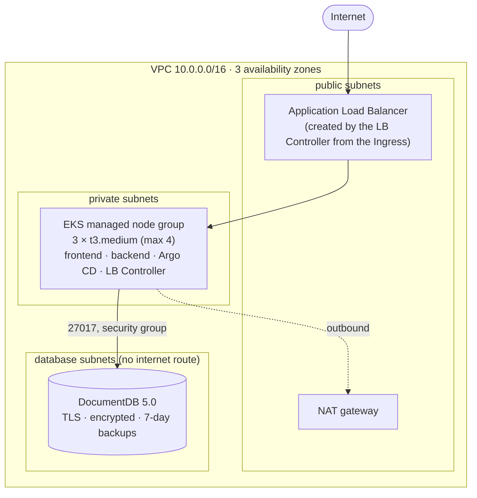

# infra: AWS infrastructure (Terraform)

Builds everything Reconcile needs on AWS **around** the app. Argo CD then
deploys the app itself from Git.

New to AWS? Read [docs/07-aws-basics.md](../docs/07-aws-basics.md) (AWS from zero), then
[docs/08-aws-reconcile.md](../docs/08-aws-reconcile.md), which walks through every file here.



## Files

| File | Creates |
|---|---|
| [`network.tf`](network.tf) | VPC, public / private / database subnets in 3 AZs, internet gateway, NAT, route tables |
| [`eks.tf`](eks.tf) | EKS cluster, managed node group in the private subnets, core add-ons, IAM for the Load Balancer Controller (Pod Identity) |
| [`database.tf`](database.tf) | DocumentDB cluster + instance(s), subnet group, TLS and audit parameters, security group allowing only EKS on 27017 |
| [`kubernetes.tf`](kubernetes.tf) | Inside the cluster: AWS Load Balancer Controller, Argo CD, `reconcile` namespace, `reconcile-backend-db` Secret |
| [`outputs.tf`](outputs.tf) | Cluster name, kubeconfig command, subnet IDs, database endpoint |
| [`variables.tf`](variables.tf) | Every setting, with defaults |
| [`backend.tf`](backend.tf) | Where state is stored (local by default; S3 example inside) |
| [`terraform.tfvars.example`](terraform.tfvars.example) | Copy to `terraform.tfvars` and edit |

## Usage

Full walkthrough: [README → Option 4](../README.md#option-4-aws-eks--documentdb).

```bash
cp terraform.tfvars.example terraform.tfvars    # set region and your IP
terraform init
terraform plan
terraform apply                                  # ~20 minutes
$(terraform output -raw configure_kubectl)       # point kubectl at the cluster
kubectl apply -f ../argocd/application-aws.yaml  # Argo CD deploys the app
```

> [!CAUTION]
> To tear down, **delete the Argo CD Application first** so the load balancer
> is removed, then run `terraform destroy`. Otherwise the leftover load
> balancer blocks deleting the VPC. See
> [docs/08-aws-reconcile.md → Tearing down](../docs/08-aws-reconcile.md#tearing-down).

## Settings you'll most likely change

| Variable | Default | Notes |
|---|---|---|
| `region` | `us-east-1` | |
| `cluster_endpoint_public_access_cidrs` | `["0.0.0.0/0"]` | **Set to your IP** (`["x.x.x.x/32"]`); this controls who can reach the Kubernetes API |
| `single_nat_gateway` | `true` | `false` = one NAT per AZ (more resilient, ~$35/month each) |
| `node_instance_types` / `node_*_size` | `t3.medium`, 3 / 3 / 4 | |
| `docdb_instance_count` | `1` | `2`–`3` adds replicas in other AZs with automatic failover |
| `docdb_skip_final_snapshot` | `true` | Set `false` to keep a backup when destroying |
| `docdb_deletion_protection` | `false` | Set `true` once the data matters |

> [!WARNING]
> `terraform.tfstate` holds the database password. It's git-ignored; keep it
> that way, and prefer the encrypted S3 backend in `backend.tf` for anything
> long-lived.

## Checks

CI runs `terraform fmt -check` and `terraform validate` on every change to
this folder ([`.github/workflows/infra.yml`](../.github/workflows/infra.yml)).
It never plans or applies, and needs no AWS credentials.
